# Lua reference

Every function the engine exposes to a script, with what each parameter does, what to set it to, what
it costs, and a picture of the result.

`docs/lua_api.md` is the index: the shape of the API, its rules and one line per op. This is the long
one — every parameter with its default and valid range, what to set it to, what it costs and a picture
of the result — organised by what you are trying to build rather than by namespace.

## Start here: from a kind of terrain to a script

**Build a terrain in this order, and check each stage before the next.** Terrains built from
photographs and videos have tended to go straight to noise, reproducing the texture of the reference
instead of its forms.

1. **Forms, without any `Noises.*`.** Walls, ridges, valleys and plateaus as shapes and profiles
   (`Shapes.*`, `Geometry.*`, `Landforms.*`, `Curves.Profile`, `Curves.Terrace`; §10), at the
   dimensions measured on the reference: wall height, step count, ridge spacing, valley profile. A
   reference blurred to the same scale should already match.
2. **Structure**: strata, terraces, faults, buttresses as a sideways displacement of the form.
3. **Erosion** (§9), and the drainage for anything with valleys (`Erosion.StreamPower`).
4. **Detail noise last**, with an amplitude stated in metres and small against the relief. Fine
   detail in a photograph is mostly light, material and erosion; noise added for it hides the forms.

Then copy the closest example, run it in the viewer, change one thing at a time.

| You want | Start from | The part to change |
| --- | --- | --- |
| Rolling hills, farmland | `terrains/rolling.lua` | fBm `amplitude` and `frequency` |
| Alpine massif, any range | `terrains/alpine.lua`, `ranges/*.lua` | the crest lines given to `Ranges.Carve` (§10) |
| Eroded rock, gullies | `terrains/badlands.lua` | hydraulic `iterations`, `erosion_rate` |
| River valleys | `terrains/riverlands.lua` | hydraulic `rain`, `capacity` |
| Sand | `terrains/dunes.lua`, `terrains/star_dunes.lua` | `Dunes.Field` (§10): `wind`, `wavelength`, `style` |
| Flat-topped hills | `terrains/mesa.lua`, `shapes/mesas.lua` | terrace `steps`, shape size |
| Tall sea cliffs, an escarpment | `terrains/cliffs.lua` | `top`, `columns`, `bays` |
| A Minecraft-scale island plateau, cliffs of clean faces onto a flat shelf | `terrains/coastal_plateau.lua` | `expand`, `displace`, `columns` |
| A volcano or an island | `terrains/crater.lua`, `shapes/volcanic_island.lua` | the profile and its radius |
| A mountain range, canyon, coast | `shapes/mountain_range.lua`, `canyon.lua`, `coast.lua` | the polyline points and widths |
| Islands, archipelagos, continents, inland seas, all land with lakes | `lands/*.lua` (`Lands.Island`, `Lands.Archipelago`, `Lands.Continent`, `Lands.Compose`) | the preset, then `edit` by id (§10) |

**Macros.** Two terrains are packaged as one call each, in the prelude: `Ranges.Carve` and
`Ranges.Finish` for mountain ranges (the alpine macro, §10) and `Dunes.Field` for sand seas (the dune
macro, §10). Start from their examples (`terrains/alpine.lua`, `ranges/*.lua`, `terrains/dunes.lua`)
before writing a terrain of that kind by hand.

**Judge erosion at the finest level.** Iterations are written for 2 m and scaled to the spacing in use
(§9), so the default 8 m view shows little of it by design. Look at it with `--max-level 0`, or zoom in
until the level changes, before adding iterations.

## How to read the pictures

Every image on this page is the same 2048 m square at 4 m per sample, exported with the same command and
differing only in the parameter being shown:

```bash
build/Release/bin/terrain_export --script assets/scripts/gallery.lua --param case=<name> --min 0,0 --max 2048,2048 --resolution 4.0 --section 256 --out out/
```

`assets/scripts/gallery.lua` carries one case per image and nothing else, so any of them can be
regenerated or changed. The files committed under `docs/images/lua/` are those exports box-filtered to
half size and 8 bits, which is 2 MB for the set instead of 18.

Grayscale images are heightfields or masks; the caption says the range they are normalised against. The
colour ones are vector outputs, where red, green and blue carry `x`, `y` and `z` remapped from `[-1, 1]`.

Two things to keep in mind when reading a number off this page. **Sample spacing matters**: anything
measured per cell — a talus, a blur radius, a slope — means something different at 1 m than at 8 m, and
the text says so wherever it applies. **Frequency and amplitude are not independent**: a 400 m hill
every 500 m is a spike, and the same 400 m over 5 km is a mountain. §Picking a frequency has the
arithmetic.

---

## 1. The shape of a script

```lua
local function main(params)
    local base = Noises.fBm{ frequency = 0.0002, octaves = 6, amplitude = 400.0, seed = params.seed }
    return {
        height  = { value = base.value, range = { -400, 400 } },
        normals = { value = Terrain.Normals{ input = base.gradient } },
    }
end

return main
```

`main` receives `params` and returns a table of outputs. Building the graph computes nothing: every call
returns a handle immediately, and the engine evaluates once, on the GPU, after the script has run.

| `params` field | Meaning |
| --- | --- |
| `params.seed` | the job seed, from `--seed` |
| `params.resolution` | metres per sample |
| `params.bounds.min`, `.max` | world bounds as `{ x, y, z }`, also as `min_x` … `max_z` |
| `params.<key>` | every `--param key=value`; numeric-looking values arrive as numbers |
| `params.shapes` | with `--shapes <file>`: drawn shapes, below |

**Drawn shapes.** `--shapes <file.geojson>` (exporter and viewer; the viewer reloads when it changes)
reads a GeoJSON FeatureCollection drawn in any editor (geojson.io, QGIS). It is data only and is checked
before the script runs: features are a `Point`, a `LineString` or a one-ring `Polygon`, positions are
`[x, z]` or `[x, z, height]` in world metres, and `properties` hold numbers, strings and booleans with a
string `kind`. The script gets `params.shapes`, a list of
`{ kind = ..., geometry = "point" | "line" | "polygon", points = { { x, z }, ... }, heights = { ... }, <properties> }`,
with a polygon's closing point dropped; what a `kind` means is the script's to decide. The sidecar records
the file's SHA-256 as `shapes_hash`. `assets/scripts/shapes/drawn.lua` with `assets/shapes/valley.geojson`
is the worked example (land, ridge, lake with `level`, river).

Each output is `{ value = <handle>, range = { lo, hi } }`. `range` is required for a scalar output
because that is what the 16-bit file is normalised against; a vector output always remaps `[-1, 1]` and
can be written as a bare handle. Outputs are requested in **name order**, not table order.

### Handles, channels and operators

A handle is one channel of one node.

| Access | Produces |
| --- | --- |
| `h.value` | channel 0, which every op has |
| `h.gradient`, `h.flow` | the op's named second channel, where it has one |
| `h.x`, `h.y`, `h.z`, `h.w` | one component, `Rn -> R1` |
| `a + b`, `a - b`, `a * b`, `a / b`, `-a` | pointwise arithmetic; either side may be a number |

A channel nothing asks for is never computed and never given a buffer, so `Noises.fBm` that is only used
for its value costs exactly one buffer.

### Mappings

| Mapping | What it usually is |
| --- | --- |
| `R2->R1` | heightmap, mask |
| `R2->R2` | gradient, flow field |
| `R2->R3` | normal map |
| `R3->R1` | density field |

Arithmetic is generic when both sides match, and broadcasts an `Rn->R1` over an `Rn->Rm`.

---

## 2. What a graph costs

Four ops read their neighbours: `Filters.Blur`, `Filters.Displace`, `Terrain.Gradient` and the two
erosions. Their radius propagates **backwards** to everything that feeds them, so every op upstream
computes a border beyond its own section. That border is the halo, and it is the main thing that decides
what a script costs.

| Op | Radius it adds |
| --- | --- |
| `Filters.Blur`, `Expand`, `Shrink` | `radius` |
| `Filters.Displace` | `radius + 1` |
| `Terrain.Gradient` | 1 |
| `Erosion.Thermal` | `iterations`, scaled to the spacing (see §9) |
| `Erosion.Hydraulic` | `iterations`, scaled to the spacing |

Radii **add** along a chain. A graph ending in `Hydraulic{iterations=24} → Thermal{iterations=12} →
Gradient` has a halo of 37 at the noise, so a 512-sample section evaluates 586² samples instead of 512²,
which is 31% more work. At 200 hydraulic iterations it would be 912² — 3.2 times the work — and the
engine refuses a halo above 255 with a message naming the node.

```
terrain.lua:9: [compile] Noise would need a halo of 400, over the limit of 255; every op between here
and an output adds its radius, and an iterative op contributes one per iteration
```

The practical consequence: **iteration counts are a cost, not a quality dial.** Before raising one, ask
whether a lower count at a coarser resolution gives the same shape.

---

## 3. Generation

### `Noises.fBm`, `Noises.Ridged`, `Noises.Billow`

Fractal noise with its exact analytic gradient, out of the same evaluation as the value. `Noises.Ridged`
and `Noises.Billow` are the same op with a different base function; `Noises.fBm{ kind = "ridged" }` is
the same thing written the other way.

| Key | Type | Default | Valid | Meaning |
| --- | --- | --- | --- | --- |
| `kind` | string | `"simplex"` | `simplex`, `ridged`, `billow`, `cellular`, `flat_middle`, `terraced` | base function; only on `fBm`. `flat_middle` is `n^3` (level ground around the mean, World Machine's Flat Middle), `terraced` four level treads per octave joined by quintic risers (Terraced) |
| `domain` | number | `2` | 2 or 3 | `R2` is `(x, z)`, `R3` is `(x, y, z)` |
| `frequency` | number | `0.002` | `> 0` | cycles per metre: wavelength is `1 / frequency` |
| `octaves` | number | `6` | 1 … 32 | how many scales are summed |
| `lacunarity` | number | `2.0` | `> 0` | frequency multiplier per octave |
| `persistence` | number | `0.5` | `> 0` | amplitude multiplier per octave |
| `amplitude` | number | `1.0` | any | output half-range when `normalize` is set |
| `offset` | number | `0.0` | any | added after accumulation |
| `seed` | number | `0` | any | salt, decorrelates nodes sharing the job seed |
| `normalize` | boolean | `true` | | divide by the sum of amplitudes |
| `multiscale` | string | `"none"` | `none`, `signal`, `elevation` | World Machine's multiscale type: `signal` weights each octave by the previous one's signal (Musgrave's hybrid multifractal, detail on crests, smooth hollows), `elevation` by the height summed so far (detail on high ground, smooth lowlands) |
| `multiscale_power` | number or field | `0.5` | `[0, 1]`, clamped | how far the weighting goes: 0 is the plain sum, 1 the full weight; a field varies it in space. Taken as locally constant by the gradient |

Channel 0 is the value, channel 1 is `gradient` (`R2->R2` or `R3->R3`).

**The three base functions**, all at `frequency = 0.0012`, 6 octaves, over `[-1, 1]`:

| `simplex` | `ridged` | `billow` |
| --- | --- | --- |
|  | 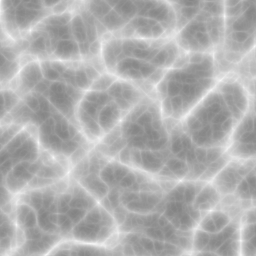 | 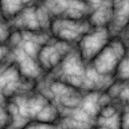 |
| Smooth hills and hollows. The default, and what a base terrain should be | Sharp crests. Note it sits high in the band: ridged is `1 - |n|` in spirit, so its mean is well above zero | Rounded lumps. Useful for dunes, clouds and boulder fields |

#### Picking a frequency

This is the parameter that decides whether the result reads as terrain or as spikes, and it cannot be
chosen without the amplitude. A wave of amplitude `A` and wavelength `L` has a maximum slope of
`2πA/L`. With `lacunarity = 2` and `persistence = 0.5` every octave contributes the **same** slope, so
the whole stack is about `octaves` times that.

Measured at 8 m sampling with `amplitude = 400` and 6 octaves:

| `frequency` | Wavelength | Mean slope | Reads as |
| --- | --- | --- | --- |
| `0.002` | 500 m | 62° | a field of spikes |
| `0.0005` | 2 km | 27° | steep alpine |
| `0.0002` | 5 km | 11° | mountain terrain |

Rule of thumb: **wavelength of the base octave ≳ 10 × amplitude**. For 400 m of relief that is a 4 km
wavelength, `frequency = 0.00025`.

| `frequency = 0.0004` | `0.0012` | `0.004` |
| --- | --- | --- |
| 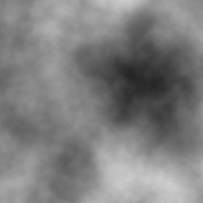 |  | 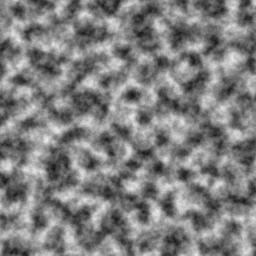 |

#### `octaves`

Each octave adds detail at half the wavelength and half the amplitude. Past the point where an octave's
wavelength is about twice the sample spacing it adds nothing but aliasing.

| 1 | 3 | 8 |
| --- | --- | --- |
| 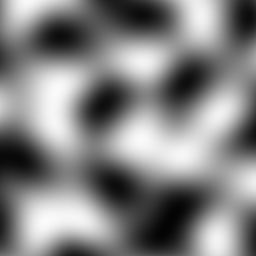 |  |  |

**Useful ceiling:** `octaves ≤ log2(1 / (frequency × 2 × resolution))`. At `frequency = 0.0012` and 4 m
per sample that is 6.7, so 8 octaves is already past the point of return — compare the last two images.

| Use case | `octaves` |
| --- | --- |
| A mask or a large-scale shape | 2–3 |
| A base terrain for export at 1–4 m | 5–7 |
| Detail for a close-up at sub-metre resolution | 8–10 |

#### `persistence` and `lacunarity`

`persistence` is roughness: how much each successive octave contributes.

| 0.3 | 0.5 | 0.8 |
| --- | --- | --- |
| 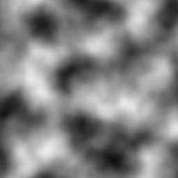 |  | 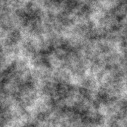 |

| Value | Result |
| --- | --- |
| 0.3–0.4 | smooth, rolling. Good under erosion, which adds its own detail |
| 0.5 | the default, and the point where every octave contributes equal slope |
| 0.7–0.9 | harsh and noisy. Rarely what a heightfield wants; fine for a detail layer multiplied into a mask |

`lacunarity` is the frequency step. 2.0 is the default because it is the value at which octaves tile the
spectrum without gaps or overlap; moving off it changes how "organised" the result looks.

| 1.5 | 2.0 | 3.5 |
| --- | --- | --- |
| 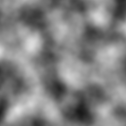 |  | 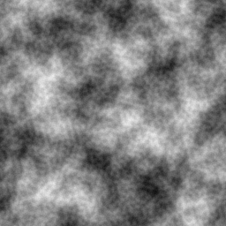 |

Below 2 the octaves overlap and the result looks blurred and self-similar; above 2.5 they separate and
the result looks like two unrelated layers stacked. Use 1.9–2.1 unless you want that effect; an
irrational-ish value such as 2.137 avoids octaves lining up into visible grid artefacts.

#### `normalize`, `amplitude` and `offset`

With `normalize = true` the octave sum is divided by the sum of the amplitudes, so the output band is
`offset ± amplitude` and you can declare an export range with confidence. With it cleared, `amplitude`
is the **first octave's** amplitude and the total is larger and harder to predict.

Leave it set unless you are reproducing a reference implementation.

#### Combines with

`Terrain.Normals{ input = base.gradient }` for free exact normals · `Masks.Slope` on the gradient to
select by steepness · `Combine.Blend` to layer a second noise · `Curves.*` to shape the distribution ·
the erosions to turn it into landforms.

#### Example

```lua
-- A base terrain with 400 m of relief over a 5 km base wavelength, and its exact normals.
local base = Noises.fBm{
    frequency   = 0.0002,
    octaves     = 6,
    lacunarity  = 2.0,
    persistence = 0.45,
    amplitude   = 400.0,
    seed        = params.seed,
}

return {
    height  = { value = base.value, range = { -400, 400 } },
    normals = { value = Terrain.Normals{ input = base.gradient } },
}
```

### `Noises.Cells`

One octave of Worley / Voronoi cells with every style World Machine's Voronoi device has. Pointwise and
R2 only. `Noises.Cellular` stays the fractal F2 - F1 / F3 - F1 with a gradient; `Cells` is the device.

| Key | Default | Meaning |
| --- | --- | --- |
| `frequency` | `0.002` | cells per metre |
| `style` | `"F1"` | `F1`..`F4` (distance to the n-th nearest site, in cells), `F2-F1`, `F3-F2`, `F3-F1`, `F4-F3`, `F4-F2`, `F4-F1`, or `cell`: a random value in [0, 1) per cell, a flat plate (WM's Cellular F1) |
| `metric` | `"euclidean"` | `euclidean`, `manhattan`, `chebyshev` (WM's Chessboard), `quasi` (Quasi-Euclidean) |
| `jitter` | `1.0` | how far each site strays from its lattice cell's centre, [0, 1]: 0 is a regular grid |
| `lattice` | `"square"` | `square` or `hex` (rows half a cell apart: hexagons at `jitter = 0`) |
| `amplitude`, `offset` | `1`, `0` | value times amplitude plus offset |
| `seed`, `position` | | as the noises |

Channel 1, `.cell`, is `R2 -> R3`: the nearest site's x and z in metres, and the cell's random value.
Feeding the site to another generator's `position` makes it constant over each cell, which is World
Machine's Crystallize, and exact at any cell size:

```lua
local c      = Noises.Cells{ frequency = 1 / 3, lattice = "hex", jitter = 0.25 }
local site   = Vec.Combine{ c.cell.x, c.cell.y }
-- Basalt columns: each the height of the slope at its centre, plus a random step of up to 0.8 m.
local column = Noises.fBm{ frequency = 1 / 400, amplitude = 30, position = site }.value + c.cell.z * 0.8
```

The forum's recipes: Cellular F1 with Quasi-Euclidean for stepped plates on a mountain (thread 7148),
F4-F1 driving a displacement for broken cliffs (7148), F2-F1 multiplied into a gradient for coastal
headlands (6012).

### `Terrain.Const`

| Key | Default | Meaning |
| --- | --- | --- |
| `domain` | `2` | 2 or 3 |
| `value` | `0.0` | the constant |

Produces `Rn -> R1`. Mostly you do not need it: a bare number works wherever a field is expected, and
the compiler folds a constant operand into the consuming kernel as an immediate, saving a dispatch and
a buffer. Reach for it when you need a constant as the `a` or `b` of a `Combine.Blend`, where both
sides must be handles.

### `Terrain.Coords`

| Key | Default | Meaning |
| --- | --- | --- |
| `domain` | `2` | 2 or 3 |

The **world position, in metres**, of each sample, as `Rn -> Rn`. This is how a script builds anything
positional — an island falloff, a linear gradient, a region mask.

It is metres at any sample spacing, so a script that places a feature at 1024 m places it there whether it
is exported at 1 m or previewed at 8 m. (It used to return the integer sample *index*, which made every
positional script describe different terrain at every resolution unless it multiplied by
`params.resolution` by hand.)

On an `R2->R2` the two components are the plane's own axes, `x` and `z`: **`.z` is the second component**,
and `.y` is the same one by position, so both spellings work. In `R3` the three components are `.x`, `.y`,
`.z` as you would expect.

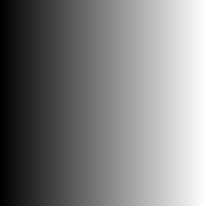
*`Terrain.Coords{}.x` over `[0, 2048]` across a 2048 m square: 0 m on the left, 2048 m on the right.*

#### Example: a circular island falloff

```lua
local p      = Terrain.Coords{ domain = 2 }       -- metres, at any resolution
local centre = 1024.0
local dx     = p.x - centre
local dz     = p.z - centre
local dist2  = dx * dx + dz * dz                   -- squared metres from the centre

-- Squared, because `^` is not one of the overloaded operators and there is no square-root op. Work
-- in squared distance and square the bounds instead: it is exact and it is one dispatch cheaper.
local inner, outer = 300.0, 900.0
local land = Curves.Smoothstep{ input = -dist2, min = -(outer * outer), max = -(inner * inner) }
local base = Noises.fBm{ frequency = 0.002, amplitude = 400.0, offset = 200.0 }

return { height = { value = base.value * land - 200.0, range = { -600, 600 } } }
```

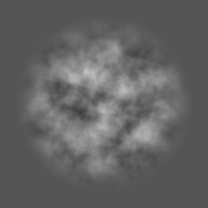
*The result: terrain inside the falloff, flat sea outside, over `[-600, 600]`.*

Note `Smoothstep` with a negated input and negated bounds: the curve ramps upward, so to fall off with
distance you feed it the negative.

---

## 4. Analysis

### `Terrain.Normals`

| Key | Default | Meaning |
| --- | --- | --- |
| `input` | required | a gradient, `R2->R2` |
| `vertical_scale` | `1.0` | multiplies the slope before normalising |

Takes a **gradient**, not a height, and produces `R2->R3`. Given a handle whose node exposes a gradient
channel it resolves it, so `Terrain.Normals{ input = base }` works for a noise handle.

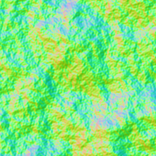
*Normals of a steep base. Green dominates because `y` is up; red and blue carry `x` and `z`.*

`vertical_scale` above 1 exaggerates relief, which is what you want when a renderer lights a heightfield
whose vertical exaggeration differs from the data. Below 1 flattens it.

| Use case | `vertical_scale` |
| --- | --- |
| Export to match the heightmap exactly | `1.0` |
| A game engine that draws the terrain at 2× vertical scale | `2.0` |
| Taking the edge off a noisy field for lighting only | `0.5` |

#### Combines with

Always with a gradient: either a noise node's exact `.gradient`, or `Terrain.Gradient` for a field that
has been through blends, curves or erosion.

```lua
-- Exact, and free: the same dispatch that produced the value produced this.
Terrain.Normals{ input = base.gradient }

-- Measured, radius 1, for a height that no longer has a closed form.
Terrain.Normals{ input = Terrain.Gradient{ input = eroded } }
```

### `Terrain.Gradient`

| Key | Default | Meaning |
| --- | --- | --- |
| `input` | required | `Rn -> R1` |

Central differences, producing `Rn -> Rn`. **Radius 1, so it puts a halo on everything upstream**, and
it is the only op in the engine that is not analytic.

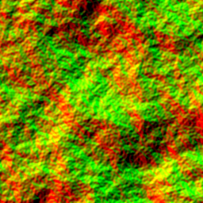
*The gradient of a heightfield: `x` in red, `z` in green, remapped from `[-1, 1]`.*

Use it only when there is no closed form left to differentiate — after erosion, after a blend, after a
curve. For a noise node, `.gradient` is exact and costs nothing extra.

### `Masks.Slope`

| Key | Default | Meaning |
| --- | --- | --- |
| `input` | required | a gradient, `R2->R2` |
| `min` | `0.0` | slope at which the mask starts to rise |
| `max` | `1.0` | slope at which it reaches 1; must exceed `min` |

Produces `R2->R1` in `[0, 1]`: 0 where the terrain is flatter than `min`, 1 where it is steeper than
`max`, smooth in between. Slope is `m/m` — `tan(angle)`, not degrees. `min = 0.577` is 30°, `1.0` is 45°.

**Feed it the gradient of a smooth field, not of your base terrain.** Differentiating an fBm weights each
octave by its frequency, so the gradient of a six-octave field is dominated by the finest octave and the
mask flickers from sample to sample. Measured on the same graph at 8 m sampling, a blend driven by a
six-octave mask has a mean slope of 38°, and by a three-octave mask 13.6°, with the relief unchanged.

| Six-octave gradient | Three-octave gradient | Narrow band, three octaves |
| --- | --- | --- |
| 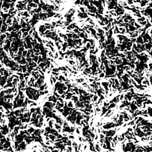 | 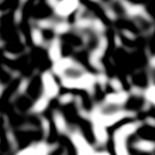 | 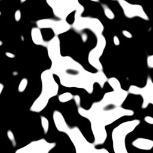 |
| `min = 0.3, max = 1.1` — flickers | the same thresholds, usable | `min = 0.6, max = 0.75` — a sharper selection |

#### Choosing thresholds

They have to bracket the slope your terrain actually has. Measure it rather than guess: export
`Terrain.Normals{...}.y` and convert, or just try `min`/`max` and look. For the base in these pictures
the slope distribution is p10 0.27, p50 0.69, p90 1.23, which is why `0.3 … 1.1` spans it.

| Use case | `min` | `max` |
| --- | --- | --- |
| Rock on cliffs, grass elsewhere | p50 | p90 |
| Snow only on gentle ground (invert with `1 - mask`) | p10 | p50 |
| A hard selection of the steepest ground | p80 | p85 |

#### Combines with

`Combine.Blend` as the `mask` · multiplied into another mask with `*` · `Curves.Power` to bias it
towards 0 or 1 without moving the thresholds.

---

## 5. Composition

### `Combine.Blend`

| Key | Default | Meaning |
| --- | --- | --- |
| `a`, `b` | required | same mapping |
| `mask` | required | `Rn -> R1` |

Linear interpolation: `a` where the mask is 0, `b` where it is 1. The mask is not clamped, so a mask
outside `[0, 1]` extrapolates — use `Curves.Clamp` if that is a risk.

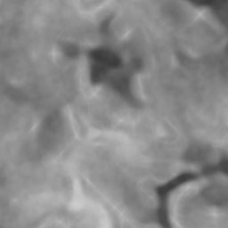
*Smooth base blended toward ridged peaks by a slope mask, over `[-400, 400]`.*

The canonical use is layering: a smooth base everywhere, something sharper where the terrain is already
steep, so peaks sit on slopes instead of floating over flat ground.

### `Combine.Min`, `Combine.Max`

| Key | Meaning |
| --- | --- |
| `a`, `b` | the two fields |

| `Combine.Min` | `Combine.Max` |
| --- | --- |
| 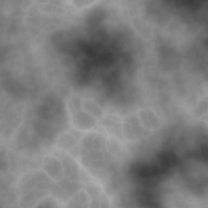 | 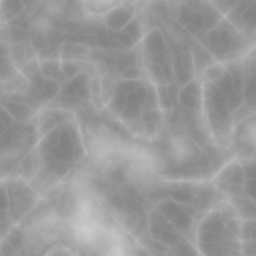 |

`Max` keeps whichever field is higher, which unions two landforms — add a plateau to a mountain range
without cutting into it. `Min` intersects, which is how you carve: a canyon field `Min`-ed into a base
removes material wherever the canyon is lower. Both leave a crease where the two surfaces cross; soften
it with a small `Filters.Blur` if it reads as an edge.

### `Combine.Atan2`

`Combine.Atan2{ y = ..., x = ... }`: the angle of the vector (x, y) in radians, (-pi, pi], 0 at the
origin. Of a gradient it is the aspect; of a position, the bearing round a point: World Machine's Angle
Selector output, which the forum uses for the radial spokes of impact debris. `Masks.Aspect` wraps it.

#### Example: a plateau that never sinks below the terrain

```lua
local base    = Noises.fBm{ frequency = 0.0003, amplitude = 300.0 }
local plateau = Terrain.Const{ value = 120.0 }
return { height = { value = Combine.Max{ a = base.value, b = plateau }, range = { -300, 300 } } }
```

---

## 6. Value shaping

All four are pointwise, cost one dispatch and add no halo.

| Key | `Clamp` | `Remap` | `Power` | `Smoothstep` |
| --- | --- | --- | --- | --- |
| `input` | required | required | required | required |
| `min` | `0.0`, the floor | `0.0`, output minimum | — | `0.0`, where the ramp starts |
| `max` | `1.0`, the ceiling | `1.0`, output maximum | — | `1.0`, where it ends; must exceed `min` |
| `exponent` | — | — | `1.0`, in `[0, 64]` | — |

| Input | `Clamp{-0.3, 0.3}` | `Remap{0, 1}` |
| --- | --- | --- |
|  | 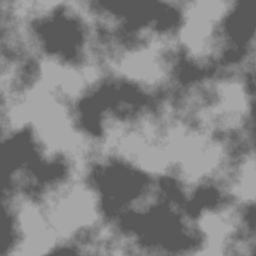 |  |

| `Power{0.5}` | `Power{3.0}` | `Smoothstep{-0.2, 0.2}` |
| --- | --- | --- |
| 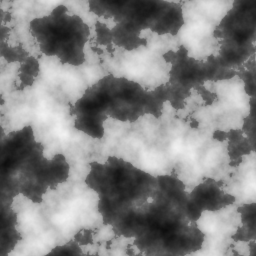 | 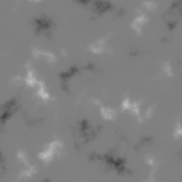 | 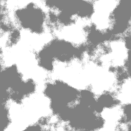 |

**`Clamp`** flattens everything past its bounds into plateaus and floors. Use it to put a hard sea level
under a terrain, or to stop erosion's overshoot from widening your export range.

**`Remap`** takes the canonical `[-1, 1]` that a normalised noise produces into `[min, max]`. It assumes
that input band — it is `min + (max - min) × (v × 0.5 + 0.5)` — so feeding it something else shifts the
result. For an arbitrary field, scale with arithmetic instead.

**`Power`** biases a distribution while preserving sign, so a signed field stays signed under an even
exponent. Exponent below 1 pushes values towards the extremes (more area at high and low); above 1 pulls
them towards zero, which on a mask means "only the strongest parts survive".

| Use case | `exponent` |
| --- | --- |
| Make a mask more selective | 2–4 |
| Make a mask more generous | 0.3–0.6 |
| Deepen valleys without touching peaks (on a `[0,1]` height) | 1.5–2.5 |

**`Smoothstep`** is the one to reach for when you want a mask out of a scalar: 0 below `min`, 1 above
`max`, with a smooth transition. It is how you turn a height, a distance or a dot product into a weight.

```lua
-- Everything above 600 m is snow, with a 150 m transition.
local snow = Curves.Smoothstep{ input = height, min = 600.0, max = 750.0 }
```

---

## 7. Filtering

### `Filters.Blur`

| Key | Default | Valid | Meaning |
| --- | --- | --- | --- |
| `input` | required | | any mapping |
| `radius` | `1` | 1 … 32 | radius in **samples**, not metres |

| `radius = 1` | `8` | `32` |
| --- | --- | --- |
|  |  | 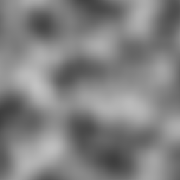 |

Two things to watch.

**The radius is in samples**, so the same script blurs a different distance at a different resolution.
If you want a blur of `D` metres, write `radius = math.max(1, math.floor(D / params.resolution))`.

**It is the most expensive halo in the engine per unit of effect**: radius 32 adds 32 to the halo of
everything upstream, which on a 512 section is 576² instead of 512², a 27% surcharge for one op. Prefer
lowering the noise's `octaves` or `persistence` over blurring the detail away afterwards — it is free,
and it does not smear the large scales along with the small.

#### Use cases

| Use case | `radius` |
| --- | --- |
| Softening the crease left by `Combine.Min`/`Max` | 1–2 |
| Smoothing a mask so a blend transition is not pixelated | 3–8 |
| Building a large-scale "shape" field to drive a mask | 16–32, or better, a 2-octave noise for free |

### `Filters.Expand` and `Filters.Shrink`

The same keys and window as `Filters.Blur`, taking the largest (`Expand`) or smallest (`Shrink`) value
instead of the mean: World Machine's Expander. On a mask, `Expand` grows the selected region by `radius`
samples and `Shrink` narrows it; on a height they are a dilation and an erosion. Follow either with a
small `Blur` for a sloped edge rather than a step. `terrains/cliffs.lua` widens an erosion's flow map
into channels with it.

| Key | Default | Meaning |
| --- | --- | --- |
| `shape` | `"square"` | the window over x and z: `square` (World Machine's Expander), `octagon` (the regular octagon inscribed in the square), `diamond` (\|dx\| + \|dz\| <= r), `disk` (dx² + dz² <= r (r + 1)) |
| `radius_map` | none | an `Rn -> R1` field, clamped to [0, 1], that scales the radius at each sample: 1 is the full window, 0 leaves the sample as it was |
| `falloff` | `"flat"` | the structuring element: `flat` takes the window's values as they are; `cone` lowers each tap (for `Shrink`, raises it) by `slope` times its distance, World Machine's Linear Slope expander; `round` by a paraboloid that reaches `slope` at `radius`, its Gaussian expander |
| `slope` | `1.0` | rise over run of the falloff, the `tan` of its angle, as `talus` is |

The shape sets the directions the faces take: on a height, a square expander turns a rounded outline into
straight faces along the two axes with square corners, an octagon into faces in eight directions, a
diamond into faces at 45 degrees, a disk into rounded shoulders. The window is read at every tap of the
square, so a shape costs what the square does. The map lets the expander act only where it is wanted
(big blocks on headlands, none on a plateau top) without a blend afterwards.
`terrains/coastal_plateau.lua` uses an octagon with a map for its cliff faces.

A cone falloff is the constant-slope expander the World Machine forum keeps asking for: `Expand` with
`falloff = "cone", slope = math.tan(math.rad(35))` and the `disk` shape skirts every peak and outline with
a 35 degree apron, whatever their height, out to `radius` samples; `Shrink` with a cone cuts V creases
into a height along its low lines (the forum's "Shrink, Linear Slope" for sharp mountain creases). The
cone is measured in true distance, so on a disk it has no straight faces along the axes, the artefact
World Machine's Linear Slope leaves. `round` gives rounded shoulders instead of straight aprons.

### `Filters.Displace`

A finished field read at each sample moved by an offset: World Machine's Displacement. A warp of the
position (`position = Shapes.Warp{}` on a shape or a noise) bends a field *before* it is built, so a
neighbourhood op after it keeps its straight lines; `Displace` bends the field *after*, an expander's faces
included.

| Key | Default | Valid | Meaning |
| --- | --- | --- | --- |
| `input` | required | | `R2 -> R1` |
| `by` | required | | `R2 -> R2`, the move in **metres** along x and z (a `Shapes.Warp` minus `Terrain.Coords`, a noise's `gradient` times a length) |
| `radius` | `8` | 1 … 32 | the longest move in **samples**; longer ones are shortened to it, direction kept |

The field is read bilinearly between samples. It adds `radius + 1` to the halo, so keep `radius` at the
largest move the offset actually makes: `math.ceil(D / params.resolution)` for a move of `D` metres.
`Terrain.Sample` evaluates it exactly, reading the field again at the moved positions.
`terrains/coastal_plateau.lua` bends its expanded cliff faces with it.

### World Machine devices built from these: `15_filters.lua`

The devices below are compositions of the ops in this reference, so they live in the prelude and say how
they are built. Each returns handles like any op.

| Function | World Machine | Built as | Returns |
| --- | --- | --- | --- |
| `Filters.Open{ input, radius, shape, falloff, slope }` | Expander, Open (Shrink-Expand) | `Shrink` then `Expand` | the field without peaks narrower than the window |
| `Filters.Close{ ... }` | Expander, Close (Expand-Shrink) | `Expand` then `Shrink` | the field without pits narrower than the window |
| `Filters.FrequencySplit{ input, radius = 8 }` | the forum's Frequency Splitter | a blur and the rest | `low`, `high`; `low + high` is the input |
| `Filters.DirectionalBlur{ input, direction, length, taps = 8, radius = 16 }` | Blur, Directional | `taps` displaced reads along `direction` degrees over `length` metres | a field streaked along one direction |
| `Masks.Convexity{ input, radius = 4 }` | Select Convexity, with a radius | `input - Blur(input)` | positive on crests, negative in hollows |
| `Masks.Aspect{ input, direction, full = 0.5 }` | Select Aspect, Angle Selector | the gradient against a direction; `Combine.Atan2` | `facing` in [0, 1], `angle` in radians |
| `Curves.Table{ input, points, smooth = true }` | Curves, Bias/Gain, Levels | a 256-entry `Terrain.Grid` read at the input | the input through a monotone curve (or straight segments) through `{ {x, y}, ... }`, held flat beyond its ends |
| `Curves.Ramp{ input, period, mode = "repeat", offset = 0 }` | Ramp, Repeat or Mirror | `x - Terrace(x)`, a sawtooth exact at any spacing | a sawtooth (or with `"mirror"` a triangle wave) between 0 and `period` |
| `Curves.Equalize{ input, region, cell = 64, amount = 1 }` | Equalizer with a captured sample | `Terrain.Sample` over `region`, its quantiles as a `Curves.Table` | the input spread evenly over its own range, the same in every section |
| `Strata.Apply{ input, step, tilt, heading, strength, sharpness, layers, bedding, mask, smoothness, flat, steep }` | Strata | a terrace of `input + plane`, the plane tilted `tilt` degrees towards `heading`, minus the plane, blended in on slopes only | height, exposure, bed index |
| `Erosion.Accumulate{ input, direction, lift = 0.2, talus = 0.6, iterations = 32 }` | Snow on a gradient with an angle selector | tilt, `Erosion.Thermal{ mass_balance = 1 }`, untilt | material built up on the side facing away from `direction` |

`Curves.Equalize` measures on the CPU, where neighbourhood and erosion ops read their input unchanged, so
measure the field before them. `Strata.Apply` shows beds where the input blurred over `smoothness`
samples is steeper than `flat`, fully from `steep` (rise over run), as the device does: a flat surface
shows none. `bedding` (any field) is added to the plane, which is how tilt and heading vary across the map.

`Curves.Ramp` on a blurred, stretched range lays ridges along its contours, the forum's folded ranges
(thread 8043):

```lua
local smooth = Filters.Blur{ input = range, radius = 12 }
local folded = range + Curves.Ramp{ input = smooth, period = 90, mode = "mirror" } * mountains * 1.6
```

---

## 8. Vectors

### `Vec.Combine`

Takes a positional list of 2 to 4 scalars and builds an `Rn -> Rm`.

```lua
local p    = Terrain.Coords{ domain = 2 }
local warp = Vec.Combine{ p.x * 0.5, p.z * 0.5 }
```

Component access is the other direction: `h.x`, `h.y`, `h.z`, `h.w` pull one component out as `Rn -> R1`.

---

## 9. Erosion

Both are iterative, and both charge their iteration count as halo. Both take an `Rn -> R1` height.

> **Units.** Slope is rise over run in both ops, so a script means one thing at any sample spacing:
> `talus = 0.7` is about 35° at 1 m and at 16 m. (Both used to be a height difference *per cell*, which
> made the same value a steeper slope at a finer spacing. Measured on a thermal-only graph at 8 m and
> 16 m over the same world positions, the difference went from 8.0 m on average to 0.02 m.)
>
> **Iterations are written for 2 m and scaled to the spacing in use.** One iteration moves material one
> *cell*, so run unchanged a script eroded by different amounts at different spacings, and a viewer that
> changes level as the camera moves showed terrain that re-eroded on every zoom. The engine now runs the
> count that gives the same amount of erosion where the cells are a different size:
>
> * iterations are multiplied by `(2 m / spacing)^2`: 24 written is 96 at 1 m, 24 at 2 m, 6 at 4 m, 2 at 8 m
>   and 1 from 16 m. A finer spacing than 2 m is capped at 96 (or at what the script wrote, if more),
>   because the count is also the halo;
> * for hydraulic erosion the per-iteration `rain`, `evaporation`, `erosion_rate` and `deposition` are
>   multiplied by `spacing / 2 m` (capped at their limits), so the totals over the run match.
>
> The log says what ran: `Erosion.Hydraulic at 8 m: 24 iteration(s) written for 2 m run as 2`. Measured on
> one 2 km terrain, the same world position at 4, 8 and 16 m differed by 0.06 to 0.24 m on average for
> thermal erosion (0.8 to 2.2 m before) and by 3.4 to 6.4 m for hydraulic (6.7 to 16.0 m before). It is an
> approximation: hydraulic erosion carves channels at the scale of the cell, so a coarser grid cannot show
> the same ones. What it does mean is that a preview at 8 m shows little erosion, because at that spacing
> there is little to show: zoom in and the level, and the erosion, follow.

### `Erosion.Thermal`

Material slides downhill wherever the drop to a neighbour exceeds the talus. Conservative: what a cell
gives away, its neighbours receive.

| Key | Default | Valid | Meaning |
| --- | --- | --- | --- |
| `input` | required | | `Rn -> R1` |
| `iterations` | `16` | ≥ 1 | passes, and the influence radius |
| `talus` | `0.7` | ≥ 0 | slope (rise over run, `tan` of the angle) below which nothing moves |
| `strength` | `0.25` | `(0, 0.5]` | fraction of the excess moved per iteration |
| `mass_balance` | `0.5` | `[0, 1]` | World Machine's mass balance: 0.5 conserves material; 0 only wears (cells give, nothing receives: it carves); 1 only fills (cells receive, nothing gives: a constant-slope apron at the talus angle) |
| `two_phase` | `false` | | rock and talus apart: rock steeper than `rock` breaks into talus in place, only talus moves; adds the `talus` channel, the talus depth |
| `rock` | `1.0` | ≥ 0 | slope above which rock breaks, two-phase only |
| `strength_map` | none | | an `Rn -> R1` field, clamped to [0, 1], that scales `strength` per sample (Talus Production) |

The three come from World Machine's Thermal Weathering and the forum's uses of it:

| Use | Settings |
| --- | --- |
| Carve valleys into a large range (thread 8043) | `mass_balance = 0`, a low `talus`, many iterations |
| A constant-slope apron round any shape (thread 8039) | `mass_balance = 1`, `talus` the slope wanted |
| Sheer planar rock faces over talus (thread 3610) | `two_phase = true`, `talus` just under `rock` |
| Talus only below some cliffs | `strength_map` 1 there, 0 elsewhere |

Measured on three blocks 20, 40 and 60 m high at 2 m: `mass_balance = 1, talus = 1` gives aprons of
48–55 degrees (the axis-only scheme reads diagonals as steeper), where `Filters.Expand{ falloff =
"cone", slope = 1 }` gives 45.0 on all three.

| No erosion | 8 iterations | 32 | 96 |
| --- | --- | --- | --- |
|  |  |  | 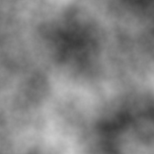 |

All three at `talus = tan(35°) = 0.70` and `strength = 0.3`, at 4 m per sample.

`strength` above 0.5 is rejected, and the reason is stability rather than taste: a cell can overshoot its
neighbour and the field oscillates instead of settling.

| Use case | `iterations` | `talus` | `strength` |
| --- | --- | --- | --- |
| Take the edge off noise, cheaply | 4–8 | `tan(40°)` = 0.84 | 0.3 |
| Talus slopes and scree below cliffs | 24–48 | `tan(33°)` = 0.65 | 0.3 |
| Settle the spoil left by hydraulic erosion | 8–16 | `tan(35°)` = 0.70 | 0.25 |
| A heavily weathered, rounded landscape | 64–128 | `tan(25°)` = 0.47 | 0.4 |

A lower talus erodes more, because more of the terrain is above the threshold. A high iteration count
with a high talus does almost nothing; a low talus with few iterations rounds only the sharpest edges.

### `Erosion.Hydraulic`

Rain, flow, sediment transport, evaporation. Carves channels and deposits fans.

| Key | Default | Valid | Meaning |
| --- | --- | --- | --- |
| `input` | required | | `Rn -> R1` |
| `iterations` | `32` | ≥ 1 | passes, and the influence radius |
| `rain` | `0.02` | ≥ 0 | water added per cell per iteration |
| `evaporation` | `0.05` | `[0, 1)` | fraction of water lost per iteration |
| `capacity` | `4.0` | ≥ 0 | sediment a unit of flow holds per unit of slope (rise over run) |
| `erosion_rate` | `0.3` | `(0, 1]` | how fast a shortfall is taken from the bed |
| `deposition` | `0.3` | `(0, 1]` | how fast an excess is laid back down |
| `flow_rate` | `0.15` | `(0, 0.25]` | fraction of a surface drop that moves per iteration |
| `hardness` | none | | an `Rn -> R1` field, clamped to [0, 1], that resists erosion: what is taken from the bed is scaled by `1 - hardness` (World Machine's Hardness), so hard beds stand as ledges; deposition is unchanged |

| No erosion | 8 iterations | 32 |
| --- | --- | --- |
|  |  | 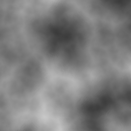 |

**`rain` is the parameter that decides whether anything happens.** The total work the water can do is
proportional to the total rainfall, and the default of 0.02 over 32 iterations is 0.64 m of water across
hundreds of metres of relief — about one metre of bed moved, which is invisible. Measured on a 400 m
terrain, 24 iterations at 8 m sampling:

| `rain` | Relief after | What you see |
| --- | --- | --- |
| 0.02 | 358 m (from 391) | essentially unchanged |
| 0.2 | 350 m | channels appear |
| 0.5 | 338 m | a drainage network |
| 10 | 341 m | the same: the op saturates, because a cell may not cut below its lowest neighbour |

So **0.2–0.5 is the working range**, and raising it further is wasted.

`flow_rate` above 0.25 is rejected: the four outflows of a cell could exceed the water it holds and the
scheme stops being stable.

| Use case | `iterations` | `rain` | `capacity` | Notes |
| --- | --- | --- | --- | --- |
| A hint of drainage, cheap | 8–12 | 0.3 | 16 | halo 12 is affordable on any section |
| Visible valleys and fans | 24–32 | 0.5 | 24–48 | the general-purpose setting |
| Deep, mature channels | 48–64 | 0.5 | 32–64 | halo 64 is 29% more work on a 512 section |
| Arid, little deposition | 24 | 0.3 | 12 | raise `evaporation` to 0.15 |

The capacities are per unit slope now, so they are roughly four to eight times what they were when the
term was a drop per cell and these were tuned at 4–8 m. A given value means the same at any spacing.
Iteration counts are for 2 m and scaled (§9).

#### The `flow` channel

Channel 1 is `flow`: water on `x`, sediment on `y`, as they stood after the last iteration. A wetness map
and a sediment map, which is what a renderer wants for putting rock against silt.

| Water (`flow.x`) | Sediment (`flow.y`) |
| --- | --- |
| 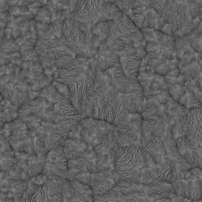 | 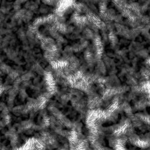 |

Asking for it costs a second section buffer and the bandwidth to fill it; a script that only wants a
height pays for neither. You may ask for `flow` **without** asking for the height.

```lua
local base   = Noises.fBm{ frequency = 0.0006, octaves = 6, amplitude = 300.0 }
local carved = Erosion.Hydraulic{ input = base.value, iterations = 32, rain = 0.5, capacity = 6.0 }
return {
    height   = { value = carved, range = { -400, 400 } },
    wetness  = { value = carved.flow.x, range = { 0, 20 } },
    sediment = { value = carved.flow.y, range = { 0, 40 } },
}
```

### Water first, then thermal

The two combine in one order: hydraulic erosion cuts channels and piles the spoil at unnatural angles,
and thermal erosion settles that spoil into talus slopes.


*`Hydraulic{32, rain = 0.5}` then `Thermal{16, talus = 4 × tan(35°)}`.*

Their radii add: this chain has a halo of 48 before anything else in the graph is counted.

---

## 10. Shapes and landforms

Noise gives texture and shapes give *intent*: a cone here, a gorge there, a mesa with a flat top. A
landform is a **shape** (where the edge is) run through a **profile** (how the ground leaves it) and
multiplied by a height. Everything below is built from ops the engine already evaluates on the GPU; Lua
only wires them together.

Two spaces, and keeping them apart is what makes the rest simple:

| Space | Unit | What it is | Made by |
| --- | --- | --- | --- |
| **Distance** | metres, negative inside | how far a sample is from a shape's edge | `Shapes.*`, `Geometry.*` |
| **Height** | metres | the terrain | `Landforms.*`, `Curves.Profile * height` |

Booleans (union, subtract) are done in distance space, with `Combine.Min`, `Combine.Max` and their
smooth versions; heights are combined as terrain, with `+`, `Combine.Max` or `Combine.SmoothMax`.

**Every shape takes `position`**, the field it is evaluated at. It defaults to `Terrain.Coords{}`, the
position in metres. Pass `Shapes.Warp{}` and the same cone is a hill instead of a drawing of one; pass
`Coords` run through your own noise and you choose how it bends.

### `Terrain.Transform`

Moves, turns and scales a position field. It is what places a shape, so one shape definition serves any
number of places.

| Key | Default | Meaning |
| --- | --- | --- |
| `position` | `Terrain.Coords{}` | the field to transform |
| `at` | `{ 0, 0 }` | where the shape's origin ends up, in metres |
| `rotation` | `0` | degrees; positive turns +x towards +z |
| `scale` | `1` | a number, or `{ sx, sz }` |
| `pivot` | `{ 0, 0 }` | the point of the shape's own space that `at` places and that rotation and scale are about |

The node it builds is the *inverse*: world positions to the shape's local space. Say where you want the
shape and the binding does the arithmetic, in double precision.

A scale of zero is an error. A non-uniform scale stops distances being distances (a circle scaled
`{ 2, 1 }` is an ellipse whose distance is not the Euclidean one), which is fine for a mask and not for a
profile that is meant to be a width in metres; use `Shapes.Ellipse` for that.

```lua
local function main(params)
    -- The same box in two places: placing is moving the positions it is evaluated at.
    local left  = Geometry.Box{ position = Terrain.Transform{ at = { -300, 0 }, rotation = 20 },
                                size = { 400, 120 } }
    local right = Geometry.Box{ position = Terrain.Transform{ at = { 300, 0 }, rotation = -35 },
                                size = { 400, 120 } }
    local both = Combine.Min{ a = left, b = right }
    return { distance = { value = both, range = { -100, 400 } } }
end
return main
```

### `Geometry.*`: signed distance to a primitive

The building blocks. Each is in its own local space (centred on the origin, unrotated) and returns the
signed distance in metres. Most scripts reach for `Shapes.*` below, which adds placement.

| Call | Keys | Distance |
| --- | --- | --- |
| `Geometry.Circle` | `radius` | `length(p) - radius`; radius 0 is a point |
| `Geometry.Ellipse` | `radii = { rx, rz }` | a bound on the distance: exact on the axes, approximate away from the edge |
| `Geometry.Box` | `size = { w, d }`, `rounding = 0` | exact, with rounded corners when `rounding > 0` |
| `Geometry.BoxChebyshev` | `size = { w, d }` | `max(\|x\| - w/2, \|z\| - d/2)`: the distance of a square pyramid's faces |
| `Geometry.Segments` | `points`, `closed = true` | a polygon (signed) or a polyline (unsigned) |

`size` is the full width and depth, which is what "a 400 by 200 box" means. `rounding` must not exceed
the smaller half-size.

**Polygons** are built as a chain of segment nodes, two segments per node, because a kernel has ten
parameter words and no buffers. The cost is real: a 40-gon is 20 passes over every sample. The limit is
128 segments, and the error says so. Inside versus outside is decided by casting a ray towards +x with a
half-open rule on z, so a vertex shared by two edges counts once and a sample exactly on a vertex is not
misclassified. The distance beside a concave corner is the distance to the nearest edge, not the
distance round it.

### `Shapes.*`: placed shapes, booleans and masks

Every constructor takes `at`, `rotation`, `scale`, `pivot` and `position`, as `Terrain.Transform` does.

| Call | Keys | Notes |
| --- | --- | --- |
| `Shapes.Circle` | `radius` | |
| `Shapes.Point` | `at` | a circle of radius 0: the distance to a point |
| `Shapes.Ellipse` | `radii = { rx, rz }` | `rotation` turns it |
| `Shapes.Rect` | `size`, `rounding`, `metric` | `metric = "chebyshev"` gives square faces; no rounding with it |
| `Shapes.Polygon` | `points` | signed; points are in the shape's own space, so `at` moves the whole outline |
| `Shapes.Polyline` | `points`, `closed` | unsigned; `closed` joins the last point to the first |
| `Shapes.Spline` | `points`, `subdivisions = 8`, `closed`, `fill` | a smooth curve through the points |

**`Shapes.Spline`** is a centripetal Catmull-Rom curve through your points, sampled `subdivisions` times
per span. Centripetal because it does not loop or overshoot when hand-placed points are unevenly spaced.
It is unsigned by default (the distance to the curve, which is what a ridge or a river needs); `fill =
true` on a closed spline is the signed distance to the region it encloses. The segment limit applies to
`spans * subdivisions`: ten points open at 8 subdivisions is 72 segments.

| Boolean | Keys | Result |
| --- | --- | --- |
| `Shapes.Union{ a, b, c, ..., smooth = k }` | | where any of them is; `smooth` rounds the seam over `k` metres |
| `Shapes.Intersect{ a, b, ..., smooth = k }` | | where all are |
| `Shapes.Subtract{ a = ..., b = ..., smooth = k }` | | `a` with `b` cut out |
| `Shapes.Mask{ shape, feather = 0 }` | | 1 inside and 0 outside, with a ramp `feather` metres each side; 0 is a hard edge |

`Shapes.Union` takes a positional list; `smooth` is the only named key.

**`Shapes.Warp{ amplitude = 60, frequency = 0.004, octaves = 3, seed = 0 }`** returns a position field
bent by noise: pass it as `position =` to any shape or landform. `amplitude` is the largest shift on each
axis in metres, and a distance is 1-Lipschitz, so a warped shape's edge never moves by more than
`amplitude * sqrt(2)`.

| Use | Recommended |
| --- | --- |
| An outline that reads as natural | `amplitude` 5-10% of the feature's size, `frequency` about 2 over its size |
| A visible meander | `amplitude` 20-30% of the feature, `frequency` 1 over its size |
| Do not | `frequency` higher than the sample spacing resolves: it aliases into a jagged edge |

```lua
local function main(params)
    local position = Shapes.Warp{ amplitude = 60.0, frequency = 0.004, seed = params.seed }

    local lake  = Shapes.Ellipse{ at = { 0, 0 }, radii = { 220, 140 }, rotation = 25, position = position }
    local islet = Shapes.Circle{ at = { 40, 10 }, radius = 40, position = position }
    local water = Shapes.Subtract{ a = lake, b = islet, smooth = 15.0 }

    -- 1 over the lake with a 20 m shore ramp.
    local mask = Shapes.Mask{ shape = water, feather = 20.0 }
    return { lake = { value = mask, range = { 0, 1 } } }
end
return main
```

### `Curves.Profile`

Turns a signed distance into a factor in `[0, 1]`: 0 outside and on the edge, 1 inside. Multiply it by a
height and it is a landform.

| `kind` | Keys | Shape of the cross-section |
| --- | --- | --- |
| `"linear"` | `width` | a straight ramp, 0 at the edge and 1 at `width` metres inside: a cone, a pyramid, a tent ridge |
| `"smooth"` | `width` | the same ramp eased at both ends: a rounded hill |
| `"dome"` | `width` | vertical at the edge and flat at the top: a dome, a crater wall |
| `"gaussian"` | `sigma` | 1 inside and falling as a Gaussian outside, with no edge at all |
| `"plateau"` | `edge = 0`, `falloff` | 1 from `edge` metres inside the outline, falling to 0 `falloff` metres outside it |

Giving a key the kind does not use is an error that names the one it does take.

`plateau` is the scarp: with `edge` and `falloff` small against the height, the wall is steep and the top
is flat. `edge = 6, falloff = 60` on a 300 m mesa is a wall about 66 m across for 300 m of rise, which is
a 78 degree face.

| Want | Kind and values |
| --- | --- |
| A cone | `linear`, `width` = the radius |
| A concave volcano flank | `linear`, then `Curves.Power{ exponent = 1.5 }` |
| A rounded hill | `smooth`, `width` = the radius |
| A crater or a dome | `dome`, `width` = the radius |
| A mesa or a platform | `plateau`, `edge` 2-8 m, `falloff` 20-80 m |
| A soft swell with no defined edge | `gaussian`, `sigma` about a third of the footprint |

### `Curves.Terrace`

Snaps a **height** to steps. Not a profile: it takes metres of altitude.

| Key | Default | Meaning |
| --- | --- | --- |
| `step` | `10` | height of one stratum, metres, greater than zero |
| `sharpness` | `0.5` | `0` eases the whole step, so the ground wavers up in S-curves; `1` is a hard riser between flat treads |

For strata that read as rock, `step` 20-50 m and `sharpness` 0.5-0.7; at 1.0 the treads are flat and the
risers vertical, which looks like a staircase. Apply it through a blend so only the walls step:
`Combine.Blend{ a = land, b = Curves.Terrace{ input = land, ... }, mask = walls }`.

### `Combine.SmoothMin` and `Combine.SmoothMax`

`Combine.Min` and `Combine.Max` with the corner rounded over `k`.

| Key | Default | Meaning |
| --- | --- | --- |
| `a`, `b` | required | the operands |
| `k` | `1` | blend width in the units of the operands, greater than zero |

Where `a` and `b` differ by more than `k` the result is exactly `Min` or `Max`; inside it the corner is
cut by at most `k / 4`. Both are symmetric in `a` and `b`. For heights `k` is metres of altitude, so
`k = 100` rounds a seam between two 500 m ridges over a 100 m band of heights, which is a wide, soft
shoulder. For distances it rounds the join of two shapes.

| Use | `k` |
| --- | --- |
| Joining two landforms so the seam is not a crease | 5-15% of the lower one's height |
| Rounding the corner where two shapes touch | 5-10% of their size |
| A crater lip against a ceiling | 20-40 m |

### `Shapes.Set`: many shapes in one node

`Shapes.Set{ elements = { ... }, reach = 2000 }` combines a list of shapes **in list order in one node**
(the `Lands` op), however long the list: a land element joins what came before it with a smooth minimum
`smooth` metres wide, a water element (`water = true`) cuts it. `.value` is the signed distance (land
negative) held to `[-reach, reach]`, `.id` the `id` of the land element a sample belongs to (0 where there
is none; land under a later water element no longer owns the sample, so an islet in a bay has its own id).
The elements are found through bins, so a sample costs the elements near it, not the whole list. Built from
`Shapes.*` nodes instead, a hundred islands would fill the graph's 1024 nodes.

| Element key | Meaning |
| --- | --- |
| `shape` | `circle` (`radius`), `ellipse` (`radii`), `box` (`size`, `rounding`), `superellipse` (`radii`, `exponent`, 4 by default: squarer above 2, a diamond at 1), `radial` (`radius`, `harmonics = { { k, amplitude, phase }, ... }`, at most 3, amplitudes adding to under 1), `capsule` (`from`, `to` or `length`, `width`), `ring` (`radius`, `width`), `arc` (`radius`, `aperture` in degrees, `width`), `sector` (`reach`, `angle` in degrees), `polygon` (`points`), `band` (`points` of `{ x, z, width }`, or `width`), `fill` (everywhere) |
| `at`, `rotation`, `scale` | placement, as `Terrain.Transform`: degrees, +x towards +z |
| `water`, `seabed` | a cut instead of land; a form of the sea floor that the coast ignores |
| `smooth` | the join's width in metres; 0 is a hard union |
| `id` | a number for `.id`; the place in the list by default |
| `profile` | `{ kind = "dome" \| "cone" (height, width) \| "plateau" (height, edge) \| "rim" (height, at, sigma, inner, width, start) \| "tilt" (height, edge, gradient, direction, floor) }`, for `relief` |
| `trench` | `{ depth, offset, width }`: a gaussian trench `offset` metres off a land element's coast, for `seabed` |

With `relief = true` the second value returned is the height of the profiles: each land element raises
its own profile over its own distance inland held to the set's (a bay or a lake cut later brings it down to
the shore), and overlapping profiles join by a smooth maximum `blend` metres wide. With `seabed = true` the
third is what to add to a sea floor: seabed elements up, trenches down. The radial outline is the
harmonic island of mapgen2 (Red Blob Games) without noise, and its area is closed-form: `pi R^2 (1 + sum
a_k^2 / 2)`.

```lua
local coast, height = Shapes.Set{ reach = 3000, relief = true, elements = {
    { shape = "radial", radius = 4000, harmonics = { { 3, 0.2, 0.5 } }, profile = { kind = "dome", height = 600, width = 3000 } },
    { shape = "ellipse", radii = { 900, 500 }, at = { 0, -3600 }, water = true, smooth = 200 },
} }
```

### `Landforms.*`: heights from shapes

Each returns a height in metres over `R2 -> R1`. `height` and `depth` may be a number or a field, so a
landform can be scaled by a mask. All take `at`, `rotation` and `position`; the round ones have no use for
`rotation`.

| Call | Keys | What it is |
| --- | --- | --- |
| `Landforms.Cone` | `radius`, `height`, `profile = "linear"` | `height` at the centre falling to 0 at `radius` |
| `Landforms.Dome` | `radius`, `height`, `profile = "dome"` | steep at the foot, flat on top |
| `Landforms.Bowl` | `radius`, `depth`, `profile = "smooth"` | a round depression |
| `Landforms.Cylinder` | `radius`, `height`, `edge = 2` | a flat-topped rise with a wall `edge` metres either side of `radius` |
| `Landforms.Plateau` | `size`, `height`, `edge = 2`, `falloff = 20`, `rounding` | a flat-topped, rotated rectangle with a scarp |
| `Landforms.Pyramid` | `size`, `height` | square faces; a rectangle gives a ridge at the top |
| `Landforms.Ridge` | `points`, `width`, `height`, `profile = "smooth"`, `subdivisions = 8`, `closed` | a raised band along a spline |
| `Landforms.Trench` | `points`, `width`, `depth`, `profile = "smooth"`, `subdivisions = 8`, `closed` | the same, cut |
| `Landforms.UValley` | `distance`, `width`, `depth`, `floor = 0.3` | a glacial U: a parabola from `depth` at a flat floor (`floor` of the width) to 0 at `width` metres of the `distance` field (a shape's `.value`, a river's distance); a height to add |

`profile` is one of `linear`, `smooth`, `dome`, `gaussian` for the ones that take it. For a ridge the
cross-section is the profile of the distance to the spline minus half the width, so `width` is the full
width of the band at its base and the crest runs along the spline.

| Want | Call |
| --- | --- |
| A volcano with a crater | `Landforms.Cone` raised to a power, cut with `Shapes.Mask` and `Combine.SmoothMin` (see `volcanic_island.lua`) |
| A mountain range | several `Landforms.Ridge`, joined with `Combine.SmoothMax`, peaks as `Cone`s on the crest |
| A river valley or a gorge | `Landforms.Trench`, or `Curves.Profile{ kind = "plateau" }` on a spline for vertical walls |
| A mesa field | `Landforms.Plateau`, several sizes and bearings, with `Pyramid` and `Dome` buttes |
| A crater | `Landforms.Bowl` with `profile = "dome"`, or `Landforms.Cylinder` with a negative `height` |

**Combines with.** `Combine.SmoothMax` to merge relief; `+` to stack a landform on a base; `Noises.*`
for what shapes cannot give (grain, scatter); `Erosion.Thermal` with a high talus to drop scree at the
foot of a scarp without rounding the top; `Filters.Blur{ radius = 1 }` after hydraulic erosion.

```lua
local function main(params)
    local position = Shapes.Warp{ amplitude = 80.0, frequency = 0.0025, seed = params.seed }

    local hill  = Landforms.Dome{ at = { -150, 0 }, radius = 260, height = 90, position = position }
    local mesa  = Landforms.Plateau{ at = { 160, 40 }, size = { 300, 200 }, height = 140,
                                     rotation = 20, edge = 4, falloff = 40, position = position }
    local ridge = Landforms.Ridge{ points = { { -400, -200 }, { 0, -260 }, { 400, -180 } },
                                   width = 160, height = 100, position = position }
    local gorge = Landforms.Trench{ points = { { -400, 220 }, { 0, 180 }, { 400, 260 } },
                                    width = 90, depth = 60, position = position }

    local land = Combine.SmoothMax{ a = Combine.SmoothMax{ a = hill, b = mesa, k = 20.0 },
                                    b = ridge, k = 20.0 } + gorge
    return { height = { value = land, range = { -100, 250 } } }
end
return main
```

### The reference terrains

Five complete terrains in `assets/scripts/shapes/`. Each runs, exports and previews, has its parameters
at the top as `params.*` with defaults, and is also exercised by `test_geometry`. The pictures are
`terrain_viewer` output.

| Terrain | What it demonstrates | Preview command |
| --- | --- | --- |
| `volcanic_island.lua` | a concave cone sized so the crater rim lands on `peak`; a crater cut with a mask and a smooth minimum; a parasitic cone; gullies kept to the flanks | `--water` |
| `mountain_range.lua` | ridges along splines joined with smooth maxima, peaks on the crest, a valley cut afterwards, relief masked to the massif | `--view 20,-24,4600` |
| `canyon.lua` | a gorge and a side canyon from splines through a plateau profile; strata by `Curves.Terrace` blended in on the walls only | `--view 25,-32,4200` |
| `coast.lua` | a closed spline filled to a signed distance; a beach and a cliff as two profiles of the same distance, blended by a feathered mask; a sea shelf; best with `--water` | `--water --view 60,-18,2300 --target -1250,20,-450` |
| `mesas.lua` | rotated plateaus of several sizes, a pyramid and two domes, strata over everything, scree from a high-talus thermal pass | `--view 35,-24,3300` |

```bash
build/Release/bin/terrain_viewer --script assets/scripts/shapes/volcanic_island.lua --water
build/Release/bin/terrain_viewer --script assets/scripts/shapes/mountain_range.lua --view 20,-24,4600
```

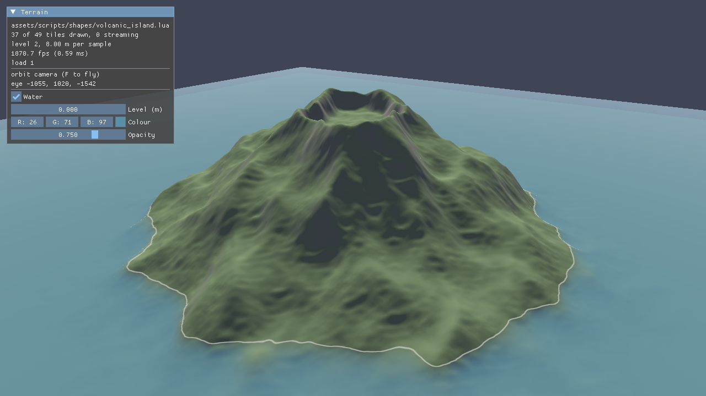

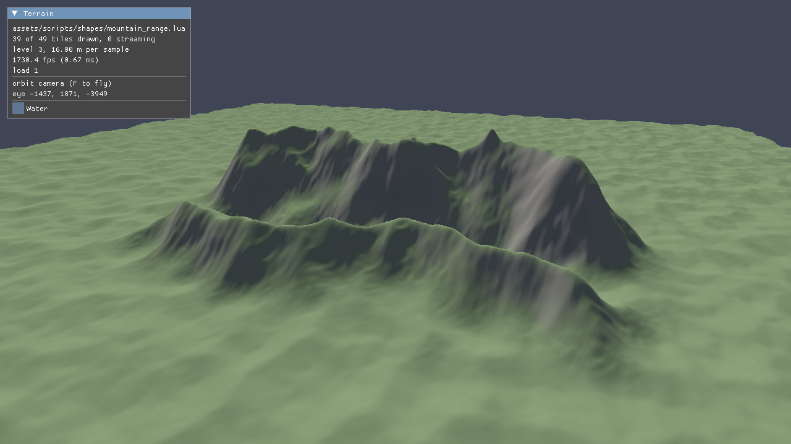

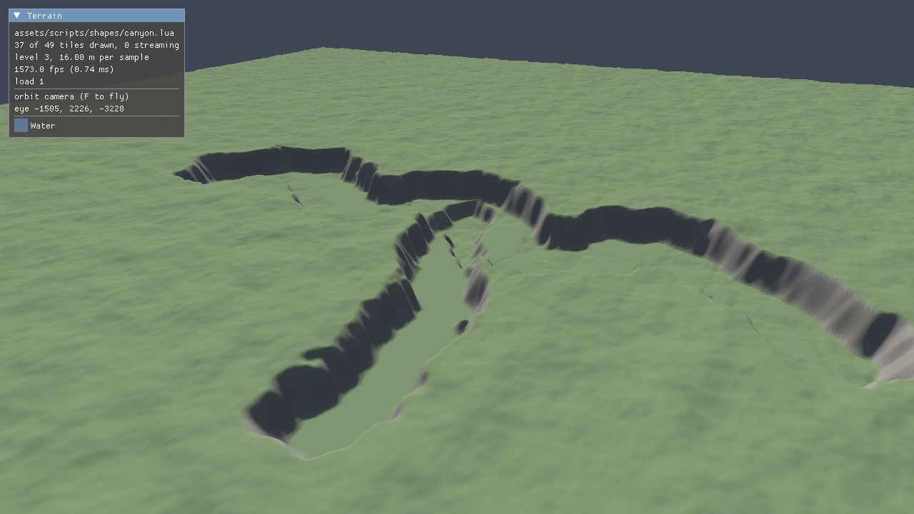

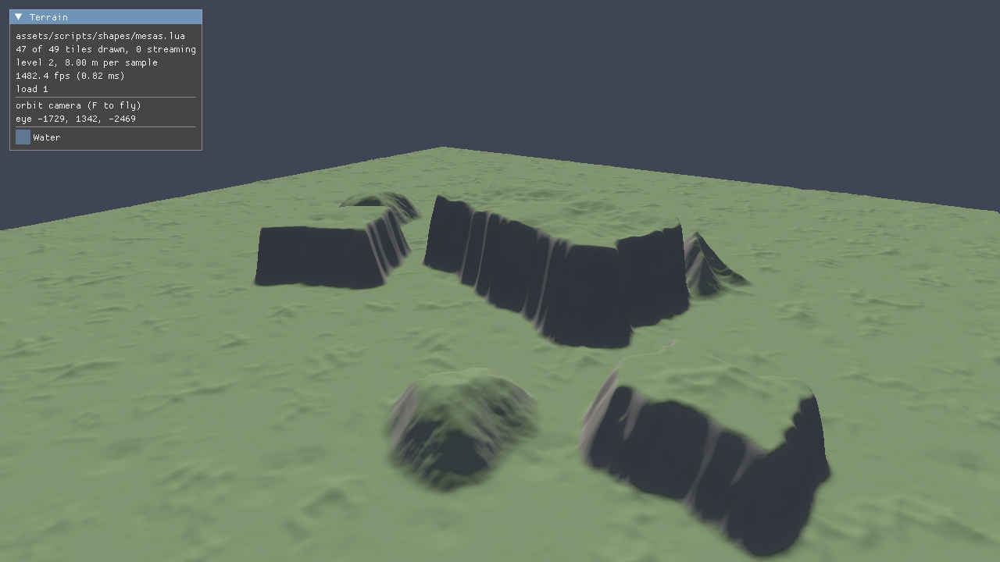

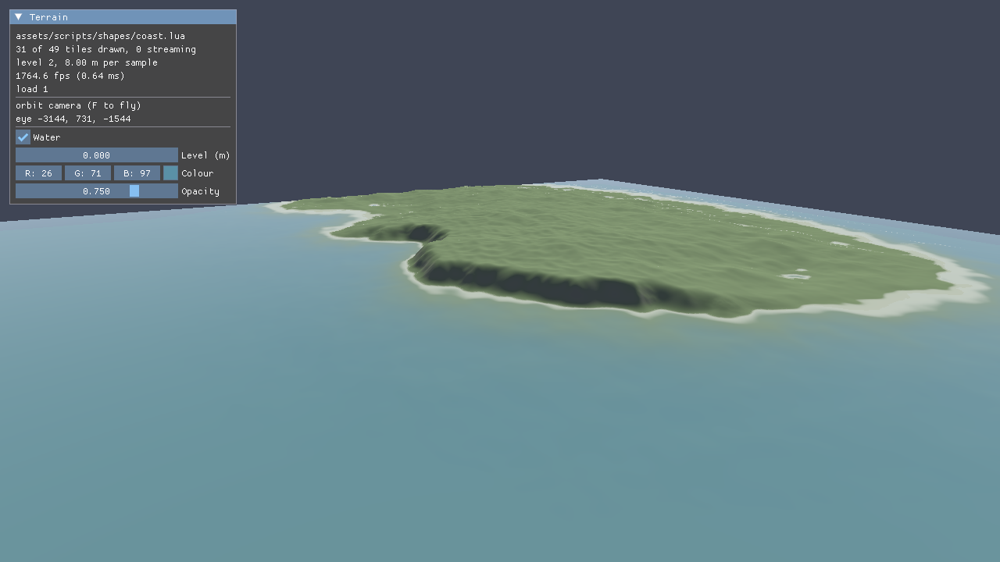

### Dune fields: `Dunes.Field` (the dune macro)

`assets/lua/prelude/40_dunes.lua`. One call is a whole sand sea:

```lua
local function main(params)
    local field = Dunes.Field{ seed = params.seed, wind = 110 }
    return field
end
return main
```

`Dunes.Field` is a dispatcher over three styles; the first is the default.

**`"procedural"`: analytic, any area, no repetition.** No grid and no simulation: every sample is a
function of its position, so it costs milliseconds (a 0.6 s script, then the GPU), is identical at any
resolution and section size, and does not repeat (measured: the autocorrelation of a 20 km export is
under 0.2 beyond 3 km). Three scales, each a family of dunes in metres:

* **Draa**, 2.6 km apart, low and broad, with a gentle lee side (a draa has no slip face worth the name).
* **Dunes**, 700 m apart, two families on winds 30 degrees apart, joined with a smooth maximum: where they
  meet the crests cross and branch.
* **Small dunes**, 170 m apart and a few metres high, summed on the gentle backs of the larger ones and
  masked off the flats, the crests and the slip faces.

How a family is built: the along-wind distance is bent by a slow noise (kept under 0.6 in slope, so a
crest never folds) and split into periods; **each dune has its own height**, a noise sampled at the
period index and across the wind, so heights vary slowly along a crest and jump between dunes at the
foot, where there is no sand to jump; most are tall for their length and a tail is low; a regional size
field (`region`, 4.5 km) takes whole areas down to almost bare ground. The profile is set in metres: a
back rising convexly at about `windward_angle`, a slip face at `repose - margin` degrees, a brink
rounded by a smooth minimum and a foot rounded by a smooth maximum, and a height capped to what fits in
the period. Slip faces are built `margin` (6) degrees under `repose` because the composition adds slope.

Measured on 2 m exports, seeds 1 to 3, 8 x 8 km: median slope 5 degrees, p95 24 to 25, p99.9 37 to 38;
0.3 % of cells over 35 degrees and 0.03 % over 40 (the edges of 2 m-high dunes, two samples wide).
`Erosion.Thermal` closes the pipeline at `repose + 2` but is not what holds the limit: it limits the
difference along each axis, not the gradient, and moves a cell per iteration, so a slip face tens of
cells long is out of its reach; on this field it moves nothing but spikes.

**`"simulated"`: Werner's slab model.** `Erosion.Wind` runs on a periodic grid (192 x 192
cells of 30 m by default, about 3.5 s, cached): slabs of sand are lifted and hop downwind, settle more
readily on sand than on bare ground and always in the wind shadow behind a crest (15 degrees), and
avalanche past the angle of repose; a fraction only creeps one cell (reptation), which rounds crests.
Dunes form, migrate and merge. The starting sand varies over kilometres (`sand`, `variety`): where it is
thick the wind builds tall sinuous ridges, where it is thin smaller ones. The grid tiles the plane
(`Terrain.Grid{ wrap = true }`, every `cells * cell` metres) in a frame turned to `wind`. Then, on the
GPU: relief scaled by `relief` and by a regional size, great dunes (`draa_*`) with rounded crests under
them, small dunes in patches, the swell of the sand sea and a light settling.

**Regions.** `area = { {x, z}, ... }` (or `areas`, a list of polygons) puts dunes only inside a polygon,
as `ridges` does for a range: the finished height is multiplied by a mask that is 1 `feather` metres
inside the edge and 0 on it (a smoothstep of the polygon's signed distance), and the edge wanders by
`edge_wander` through a warp at the scale of the fade, so a region is a field of sand and not a drawn
outline. It works with every style and adds a `mask` output (0 to 1). Outside the regions the ground is
flat. Because the height is scaled, slopes only get gentler towards the edge: on the example, p99.9 of
the slope is 36 degrees inside and 33 in the fade band. `terrains/dune_regions.lua` has two regions:

```bash
build/Release/bin/terrain_viewer --script assets/scripts/terrains/dune_regions.lua --view 190,-18,5500 --target -800,0,-300
```

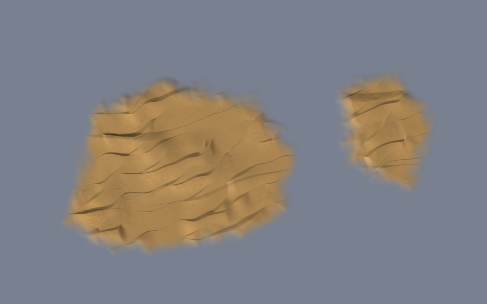

**What the viewer shows.** Its sun is fixed, so the same field reads differently with the wind: with the
lee faces turned to the sun (`wind` near 20) the slip faces are thin bright lines and the backs, which
give the dunes their volume, are barely shaded; with the sun to the side (`wind` near 110, the default)
the field reads as soft dunes with volume; with the lee faces away from it (`wind` near 200) the slip
faces are dark. That is lighting, not geometry: the export is the same field turned.

**Keys.** `style` is `"procedural"` (the default), `"simulated"` or `"star"` (below). `"transverse"` is
a deprecated alias of `"simulated"` and prints a warning. A key that belongs to another style is an
error that names the style, not something silently ignored.

Lengths and heights are metres, angles degrees. Defaults are in `Dunes.Field` and `Dunes.Simulated`
(`assets/lua/prelude/40_dunes.lua`), not in the example scripts.

| Key | Styles | Default | |
| --- | --- | --- | --- |
| `seed` | all | 0 | integer, from `--seed` |
| `wind` | all | 110 (`procedural`), 20 (`simulated`, `star`) | degrees, the direction the wind blows towards |
| `repose` | all | 33 | the angle slip faces stand at; sets the slab height in `simulated` |
| `swell` | all | 25 (`simulated`), 64 (`star`) | metres: amplitude of the swell of the sand sea |
| `wavelength`, `height` | procedural | 700, 95 | between dunes; the tallest dune (the cap is 0.125 x `wavelength`) |
| `sinuosity`, `windward_angle`, `margin` | procedural | 0.35, 10, 6 | bend of the crests (0 to 0.4); angle of the back; degrees the slip face is built under `repose` |
| `draa_wavelength`, `draa_height`, `small_wavelength`, `small_height`, `region` | procedural | 2600, 70, 170, 5, 4500 | the other scales and the regional size field, metres |
| `area` or `areas` | all | none | a polygon, or a list of polygons, as lists of `{ x, z }` metres: dunes only inside (see below) |
| `feather`, `edge_wander` | all, with `area` | 500, 0.35 x `feather` | metres: the fade to flat ground inside the edge, and how far the edge wanders |
| `sand` | simulated | 70 | metres of starting sand |
| `variety` | simulated | 0.3 | how much it varies, by region |
| `cells`, `cell` | simulated | 192, 30 | simulation grid; it tiles every `cells * cell` metres |
| `iterations` | simulated | 260 | picks per cell: few leave grain, many merge everything |
| `smooth` | simulated | 3 | 3 x 3 passes over the simulated sand |
| `relief` | simulated | 0.75 | scale of the simulated dunes' height |
| `draa_wavelength`, `draa_height` | simulated | 2600, 90 | the great dunes under them, metres |
| `small_wavelength`, `small_height` | simulated | 200, 2.5 | small dunes on gentle slopes; height 0 turns them off |
| `wavelength`, `height` | star | 650, 80 | between crests; dune height |
| `sinuosity`, `back`, `flats`, `small` | star | 0.45, 0.8, 0.28, 0.12 | bend of the crests; windward fraction of a period (0.5 to 0.95); bare ground below this fraction of height; small dunes as a fraction of `height` |

```bash
build/Release/bin/terrain_viewer --script assets/scripts/terrains/dunes.lua --view 200,-30,4000
build/Release/bin/terrain_viewer --script assets/scripts/terrains/star_dunes.lua
```

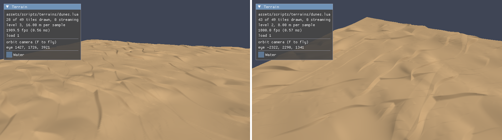

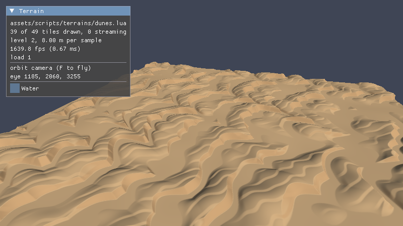

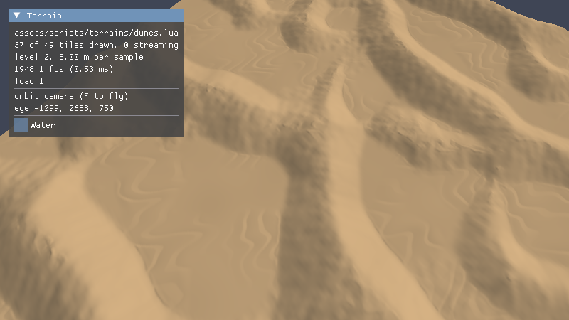

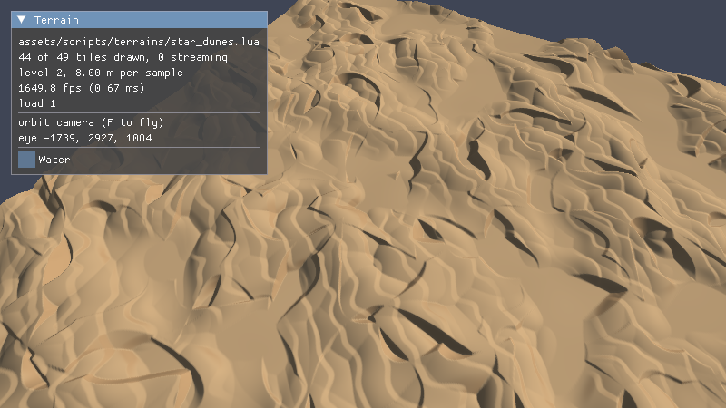

### Mountain ranges: `Ranges.Carve` and `Ranges.Finish` (the alpine macro)

The alpine terrain, packaged: a range is a list of crest lines, and the prelude
(`assets/lua/prelude/30_ranges.lua`) does the rest. Every range example and `terrains/alpine.lua` is a
dozen lines:

```lua
local function main(params)
    local h = params.height or 2200.0
    local structure, tallest, sun = Ranges.Carve{
        seed = params.seed,
        ridges = {
            { points = { { -6200, -900 }, { -2600, 300 }, { 400, -200 }, { 3200, 700 } },
              height = h, width = 5200 },
            { points = { { -1200, 200 }, { -600, 2600 } }, height = h * 0.7, width = 3400 },
        },
        peaks = { { at = { -400, 0 }, height = h * 1.3, radius = 3600 } },
    }
    return Ranges.Finish(structure, tallest, params.seed, nil, sun)
end
return main
```

**What `Ranges.Carve` does**, in order, on a CPU grid of about 230 x 230 cells over the range and a
margin (its edge is the base level):

1. **Uplift.** Each crest lifts the ground within `width` of it, its height wandering along the line;
   the plan is bent by `wander` metres so no crest is straight. A summit is placed every ~5 km along
   every crest (one of them 1.45 times the crest, the rest 1.12 to 1.32), plus any `peaks` given. The
   uplift is gently stepped (`shoulders`), so benches survive the erosion.
2. **Rivers.** `Erosion.StreamPower` runs ~380 steps: the valleys join into larger ones down to the
   plain and leave sharp ridges between them. `talus` (default 0.6, about 31 degrees) is the steepest a
   hillslope may stay; `diffusion` is relative to the cell, so valley spacing does not depend on the grid.
3. **Cirques** under every peak (three each, a steep headwall over a spoon floor), then a short second
   run with twice the talus, which keeps their walls.
4. **Deposition** in the low third: valley floors fill flat towards a broad average.
5. **U valleys.** The drainage is traced; around every cell where at least `glacier_area` (2.5 km²)
   drains, the ground is lowered to a parabola rising from the river, wider the larger the catchment.
6. **Talus cones** at 33 degrees (`repose`) under every wall, capped in thickness.
7. **Shadow.** For each cell, whether the viewer's sun clears the horizon.

It returns the structure (a `Terrain.Grid`, read through a broad warp so no channel runs along the grid),
the tallest height, and the shadow grid.

**What `Ranges.Finish` adds** on the GPU: tilted strata in patches on the middle slopes (cliffs and
ledges; `dip`, `bed`, `strata`), scree from a thermal pass kept where it lies above the ground, two
generations of `Erosion.Gullies`, the hydraulic and thermal passes, a blur kept off the crests, and the
outputs `height`, `normals` and `shadow`. The plain around the range is flat.

| `Ranges.Carve` key | Default | |
| --- | --- | --- |
| `ridges` | required | `{ points = { {x, z}, ... }, height = m, width = m }`, one per crest |
| `peaks` | none | extra summits, `{ at = {x, z}, height = m, radius = m }` |
| `seed` | 0 | everything hashed from it |
| `k`, `diffusion`, `talus`, `steps`, `lift` | 0.016, 0.012 x cell², 0.6, 380, 2.4 | the simulation |
| `cells`, `extent`, `center`, `cell` | 230 cells over the crests and a margin | the grid |
| `wander`, `wobble` | 1300 m, 180 m | how far the plan bends; the warp the grid is read through |
| `shoulders`, `glacial`, `glacier_area`, `cirques`, `fill`, `repose`, `talus_cones` | on | each stage, `false` or 0 to skip |

**Cost.** About 5 s for the first run (the simulation is 3 of them). The result is cached by a hash of
everything that goes in, so the viewer, which re-runs the script whenever the level of detail changes,
does not simulate again; a level change costs the Lua around it, about a second.

**Examples:** `terrains/alpine.lua` (main crest, three spurs, two named summits), and in
`assets/scripts/ranges/`: `sierra.lua` (one long range), `arc.lua` (a bow with outer spurs),
`parallel.lua` (two ranges and the valley between), `knot.lua` (three ranges meeting at a massif).

```bash
build/Release/bin/terrain_viewer --script assets/scripts/terrains/alpine.lua
build/Release/bin/terrain_viewer --script assets/scripts/ranges/knot.lua --view 170,-26,20000
build/Release/bin/terrain_viewer --script assets/scripts/terrains/alpine.lua --detail 1 --ring 4
```

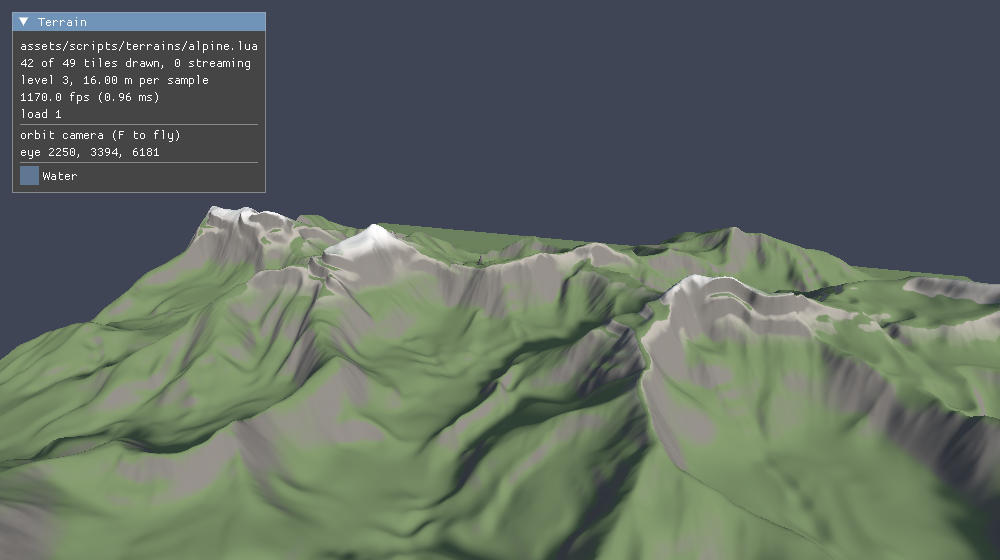

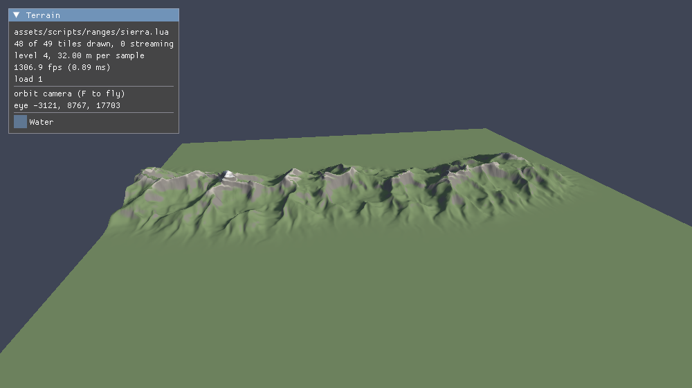

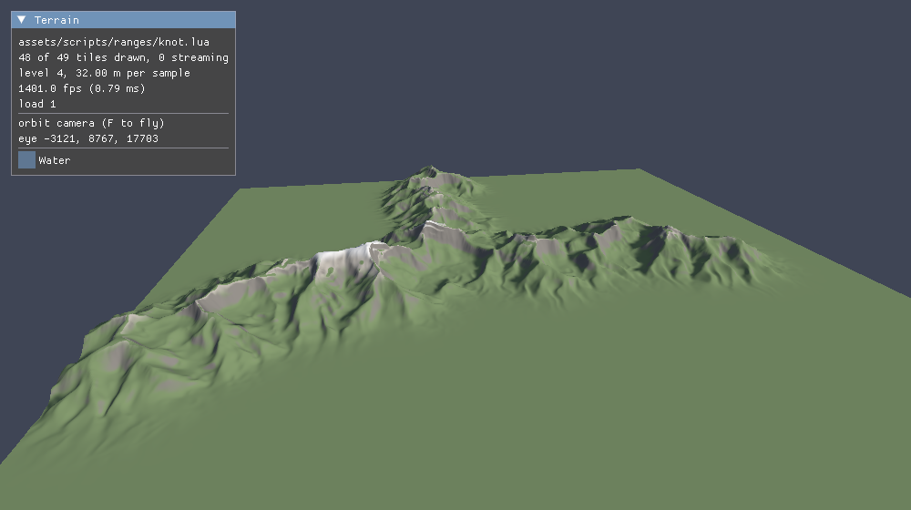

**The limit of all of this is the heightfield.** One height per (x, z): no caves, arches, overhangs or
stacked surfaces. A scarp can be vertical, never undercut.

---

### Islands, archipelagos and continents: `Lands.*` (the lands macro)

Land and sea are **composed from simple shapes first, detail after**: `Lands.Compose` takes a list of
`Shapes.Set` elements (land, water and sea-floor forms, each with an id), raises each land element by its
own profile, and builds the coast, the shore and the sea floor from the one signed distance. **Nothing is
assumed about the land**: where it is, how much of the map it covers (all of it, none of it), and how it
rises (a dome, cliffs higher than the interior, a caldera below the sea) are all said by the script.

```lua
local land = Lands.Compose{
    seed = 1, frame = { size = 24000 }, height = 900, profile = "dome",
    elements = {
        { id = "main", shape = "radial", area = 150e6, harmonics = { { 2, 0.15, 0.3 }, { 5, 0.06, 1.2 } } },
        { id = "peninsula", shape = "capsule", from = { 4500, 1200 }, to = { 9500, 2600 }, width = 2200,
          smooth = 900, profile = { "dome", height = 260 } },
        { id = "bay", shape = "ellipse", water = true, radii = { 2200, 1300 }, at = { -800, -6200 }, smooth = 300 },
    },
    edit = { peninsula = { scale = 1.2 } },   -- refine by id without rewriting the element
}
return land:outputs{ "coast_type", "land_mask", "coast_sdf", "region_id" }
```

| Key | Meaning |
| --- | --- |
| `frame` | `{ size = m }`, a map centred on the origin, or `{ world_cell = m, region = { x0, z0, x1, z1 } }` for the unbounded world: the coast's and the shore's scales follow the world cell, never the window, so exports of any window agree, and `region` is only where the report measures. `edge_margin = m` keeps every scatter that metres from a bounded map's edge. In a bounded map any position (`at`, `from`, `to`, `points`, a scatter's `center`, `path` and `centers`, a ridge's `points`) may be a percentage of the map from its corner: `at = { "30%", "75%" }` |
| `elements` | `Shapes.Set` elements, plus `area` (square metres, sizes the shape from its closed-form area), `aspect` (x over z), `role` (`"lagoon"` makes a water element shallow; any other text is a label), `margin` (`"active"` adds a trench at the foot of the slope, or `{ depth, offset, width }`), `profile` as a preset, `relief = true` (an element that changes no coast and adds its profile to the land under it: a massif, a negative dome for a basin) and `ridge` (below) |
| `profile` | the default profile of land elements: `dome`, `cone`, `plateau`, `rim` (a crest near the coast over a lower interior), `caldera` (the crest round a floor below the sea), `tilt` (a plane rising towards `direction`) or `flat`, or `{ "rim", inner = 140, ... }` to set its numbers. Widths default to fractions of the element's inscribed radius and heights to `height`. A land element with no profile is an error |
| `height` | the profiles' height in metres; a seabed element's is half the abyssal depth |
| `hypsometry` | `low`, `balanced` (default) or `high`: a fixed monotone curve of the height, so drainage order is kept |
| `land_fraction`, `classes` | a bounded map's land share, reached by rescaling the scatters; the report's classes by area (below) |
| `edit`, `remove` | `{ [id] = { key = value } }` replaces keys of an element; `scale` multiplies (an element sized by `area` grows by its square) and `offset = { dx, dz }` moves it. `remove = { id, ... }` drops elements |
| `margin`, `coast`, `shelf_*`, `slope_width`, `abyssal_depth`, `beach_*`, `cliff_*`, `lagoon_depth`, `wave_from`, `hardness`, `sediment`, `shore_band` | the sea floor and the shore, as before |

The products are those of the table below; `region_id` is the id of the element a sample belongs to (its
place in the list). An export's `metadata.json` holds `script_report.lands`: every element as resolved (id,
shape, kind, centre, closed-form `area`) and what it measured on the frame (`area_measured`, `centroid`,
`highest`), with the land fraction. `tools/dev.sh lands <script> --bounds ...` prints it next to
`terrain_metrics --by-id`, and `tools/dev.sh lands-check ... --expect count=6,area=2e6..4e6,land=0.2..0.4`
checks a request against what was built.

**Outlines from Azgaar's templates: `Lands.Template`.** The presets of `Lands.Island`, `Lands.Archipelago`
and `Lands.Continent` that one of Azgaar's heightmap templates draws (volcano, high_island, low_island,
atoll; scattered, shattered; continent, pangea, old_world, mediterranean, peninsula, isthmus, fractious,
taklamakan) take their outline from it by default; `outline = "shapes"` builds the composition of shapes
below instead, with element ids an `edit` reaches. `Lands.Template{ template = ..., seed, size, height,
land_fraction }` builds one directly:

1. **His generator, step by step**: a grid of about `cells` cells (10 000 by default) on a square lattice of
   points jittered by 0.9 of their spacing, heights 0 to 100 kept as whole numbers, his sea level 20, and his
   steps with his numbers (`Hill` grown cell by cell outwards, `Range` along a greedy walk with spurs walking
   downhill, `Trough`, `Strait`, `Pit`, `Mask`, `Invert`, `Add`, `Multiply`, `Smooth`). `steps` takes a
   template of your own in his syntax (`"Hill 1 90-100 44-56 40-60\nMask 3 0 0 0"`). Over six seeds the
   share of land falls in the spread of his own generator for every template but taklamakan, short by about
   0.09 on a square map (its hills hug the edges).
2. **The coast** on a raster `detail` (4) times finer than the cells: the cells' heights interpolated, read
   through a broad `bend` (0.08 of the map) so a masked rectangle comes out lobed; the coast frayed by a
   fractal `fray` cells deep (2.5), calm or jagged by his roughness field; then `fjords` (10, none on an
   atoll) fjord systems where the land drains: the largest basins round two or three fjord coasts drowned
   from their outlets upstream with their tributaries, widest at the mouth, their valleys cut into the
   ground behind, and the land they take given back as a rim on the coast so the share of land stays; the
   exact distance to it. Below a cell, a warp by the same field, faded out two cells from the coast.
3. `land_fraction` sets the sea level by quantile; `roughness` scales the fray and the warp.
4. **The ocean floor** (`ocean`, on unless `false`), the unbounded world's at the map's scale: past a shelf
   0.045 of the map wide the floor goes down in eleven wavering walls to a drowned land of 22 strata, which
   falls away from the land masses to nearly four times the abyssal depth and holds guyots and hotspot
   chains, mid-ocean ridges with their rift and faults, trench arcs to 5.5 times the abyssal depth and
   canyons out from each mass; over the map's outer twenty-fifth it goes to the far floor's depth.

The report lists the land masses (`mass/1` the largest, with area and centroid, classed `continent`,
`island` or `isle`) and the water bodies; `region_id` is the mass's rank. It takes about 4 s of script on
a 48 km map, 1.5 s more for the ocean floor (the raster is built in Lua).

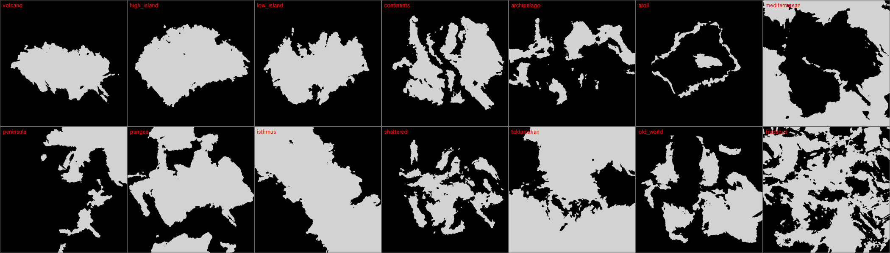

**`Lands.Island{ preset = ..., seed, size, land_fraction, height, outline }`** builds an island from a preset.
With `outline = "shapes"` (and for caldera, rim_island and mesa_island, which have no template),
`Lands.Preset{ name = ... }` returns the `Lands.Compose` table to change before building, and any
`Lands.Compose` key passes through, so `edit` reaches the preset's elements by id. The table lists the
compositions:

| Preset | Elements (ids) | Default land, height |
| --- | --- | --- |
| `high_island` | `main` (lobed dome), `lobe1`, `lobe2` (lower domes joined to it), `bay` | 30 %, 900 m |
| `low_island` | `main` (flat, a few metres) | 25 %, 12 m |
| `volcano` | `main` (cone, active margin), `parasite` (flank cone) | 20 %, 1400 m |
| `caldera` | `main` (caldera, floor below the sea), `breach` (a sector of sea) | 20 %, 650 m |
| `rim_island` | `main` (rim: cliffs higher than the interior) | 28 %, 380 m |
| `mesa_island` | `main`, `butte` (plateaus) | 25 %, 320 m |
| `atoll` | `reef` (ring), `lagoon`, `pass1`..`pass3`, `motu` | 8 %, 5 m |

**Scatter: many islands from one element.** An element with `scatter = { ... }` stands for many: its other
keys are the template (shape, profile, `aspect = { min, max }`; a radial outline and the turn are drawn per
island when not given), and each island gets the id `"<id>/<slot>"`, which `edit` and `remove` reach.

| `scatter` key | Meaning |
| --- | --- |
| `count`, `area = { min, max }` | how many, and their areas in square metres; `distribution = "log"` (default: small ones outnumber large ones) or `"uniform"` |
| `spacing`, `margin` | metres kept between bounding circles (and from the land declared around it; negative lets them overlap and merge); metres kept from the map's edge (`frame.edge_margin` by default) |
| `pattern` | `uniform` (dart throwing, Bridson's 30 tries a slot), `cluster` (`clusters`, `spread`: a Neyman-Scott process), `line` (`path`, `decay`: sizes falling along it, `wander`), `arc` (`center`, `radius`, `from_angle`, `to_angle`), `ring` (`center`, `radius`), `grid`, `centers` (`centers = { { x, z, area }, ... }`) |
| `region` | a `Shapes.Set` element the centres must fall in |

Each slot draws from a hash of (seed, id, slot) and is placed against the slots before it, so asking for one
more keeps the others where they were; a slot without room shrinks (on a curve further) and is otherwise
skipped, and `land.info.scatters` / the report say how many were placed. Water can be scattered too (channels
over land, lakes). `land_fraction` on a bounded map rescales the scatters until land covers that share. In
the unbounded world (`frame.world_cell`) `uniform` and `cluster` give `count` per world cell: each cell
proposes candidates from its own hash and one stays when no conflicting candidate outranks it (Wei's
parallel Poisson rule in one pass), so two windows over the same cells keep the same islands. The other
patterns are explicit geometry and work anywhere. Islands are classed by measured area in the report:
`continent` (a tenth of a bounded map, 10 000 km2 in the world), `island` (a thousandth, 1 km2) or `isle`;
`classes = { continent = m2, island = m2, sea = m2 }` overrides them. Water bodies are reported too (`land.info.waters`, `script_report.lands.waters`): each connected body with its area, whether it touches the frame, the water elements whose centre falls in it, and its class: the `role` of the first of those, else `ocean` if it touches the frame, `sea` over a hundredth of a bounded map (1000 km2 in the world), else `lake`.

The sea floor is built on the coast distance with the land joined by a smooth minimum half the shelf and
slope wide, so it has no crease midway between two coasts and a strait between near islands is shallow.

**`Lands.Archipelago{ preset = ..., seed, size, count, area, land_fraction, height, outline }`** (48 km by
default; scattered and shattered come from a template unless `outline = "shapes"`; `count` and `area`, in
square metres, override the composition's, which are fractions of the map):

| Preset | What | Ids |
| --- | --- | --- |
| `scattered` | islands of many sizes anywhere, apart by straits | `isles/N` |
| `cluster` | islands round three centres | `isles/N` |
| `hotspot` | a chain shrinking along a bent line | `chain/N` |
| `arc` | an island arc, and one trench along its convex side (a seabed `arc` with a negative cone profile) | `arc/N`, `trench` |
| `atolls` | rings of reef round lagoons | `atolls/N`, `atolls/N/lagoon` |
| `shattered` | a land block cut by scattered channels | `land`, `channels/N` |
| `chain` | islands side by side along a band | `chain/N` |

**Ridge: a range from one element.** `{ id = "range", ridge = { points = { { x, z }, ... }, width = m, height = m,
saddles = 3, spurs = true, spacing = m } }` stands for the relief elements of a mountain range along `points`:
the crest in `saddles + 1` pieces (`"range/crest/N"`), each a band tapering to 0.4 of `width` at its ends so the
pieces meet in saddles, the highest exactly `height` over the land and the others 0.8 to 1 of it, and spurs
(`"range/spur/N"`) every `spacing` metres along it (1.2 widths by default), on alternate sides and turned 20 to
40 degrees from the crest's normal, 0.55 of its height. Relief changes no coast: where a range runs out to sea
it stops at the shore.

**`Lands.Continent{ preset = ..., seed, size, land_fraction, height, outline }`** builds a continent or any
other land; the presets with a template draw it unless `outline = "shapes"` (inland_sea, all_land, lakeland
and ocean_only are compositions only). `Lands.Preset{ name = ... }` returns the composition to change before
building. Sizes are fractions of
the map; the whole composition turns by an angle drawn from the seed (not `taklamakan`, whose ranges follow
the map's edges). The land is a low plateau (0.08 of `height`) and the ranges carry the relief.

| Preset | What | Ids | Map, height |
| --- | --- | --- | --- |
| `continent` | a superellipse block with three lobes, two gulfs on its shore, a main range and lower hills | `main`, `lobe1`..`3`, `gulf1`, `gulf2`, `range/...`, `hills/...` | 192 km, 2200 m |
| `pangea` | four blocks round a central band, two inland seas, two ranges | `block1`..`4`, `band`, `sea1`, `sea2`, `range1/...`, `range2/...` | 192 km, 2000 m |
| `old_world` | three landmasses apart by a winding strait | `block1`..`3`, `strait`, `range1/...`, `range2/...` | 192 km, 2000 m |
| `mediterranean` | land all round a long sea with islands in it, ranges along both shores | `land`, `sea`, `isles/N`, `north/...`, `south/...` | 96 km, 1600 m |
| `inland_sea` | a continent with a closed sea inside | `land`, `sea`, `range/...` | 96 km, 1400 m |
| `peninsula` | a mainland along one side, a peninsula with a spine, islands off its tip | `mainland`, `peninsula`, `isles/N`, `spine/...` | 48 km, 900 m |
| `isthmus` | two landmasses joined by a narrow, low isthmus | `west`, `east`, `isthmus`, `west_range/...`, `east_range/...` | 48 km, 700 m |
| `fractious` | many pieces merging into each other, cut by channels | `pieces/N`, `channels/N` | 96 km, 900 m |
| `taklamakan` | all land: a closed basin ringed by ranges on four sides | `land`, `north/...`, `south/...`, `west/...`, `east/...`, `basin` | 96 km, 2400 m |
| `all_land` | all land: a plain, an upland and hills (`land_mask` is 1 everywhere) | `land`, `upland`, `hills/...` | 24 km, 500 m |
| `lakeland` | all land with twelve lakes | `land`, `lakes/N` | 24 km, 120 m |
| `ocean_only` | no land: seamounts and a guyot | `seamounts/N`, `guyot` | 48 km |

`test_compose` holds them to what they promise: a ridge's crest within 2 % of `height` and its spurs within
10 % of `spacing`, the peninsula within 5 % of its drawn width, the lakes' areas, one inland `sea` that
touches no frame, and the land shares against bands measured on reference heightmaps (the coast's dimension
and the hypsometric integral are below the references until the shapes get their detail).

`Lands.Island`, `Lands.Archipelago` and `Lands.Continent` no longer take the old keys of the grid-built macro
(`layout`, `roughness`, `dissection`, `cells`, `aspect`; for an island also `count`, `area`, `areas`) and say
what to use instead.

There is **one sign convention: land d < 0, coast d = 0, sea d > 0**. Products, each asked for by name in
`land:outputs{ ... }` (`height` and `normals` are always there; a script holds at most eight outputs):

| Product | Meaning |
| --- | --- |
| `coast_sdf` | signed distance to the coast, metres, land negative |
| `land_mask` | `1 - Smoothstep(-w, w, d)`: 1 on land, 0 at sea |
| `land_height` | the ground: the profiles and the relief elements, shaped as a beach or a cliff at the shore |
| `bathymetry` | the sea floor, negative: beach face, shelf, break, slope, abyssal, plus seamounts, guyots and trenches |
| `surface_height` | the two joined at the coast; it is the script's `height` |
| `shore_mask` | 1 on the coast, falling to 0 `shore_band` metres either side |
| `coast_type` | 0 a beach, 1 a cliff (hardness, sediment, exposure and curvature) |
| `region_id` | the element a sample belongs to |

The examples in `assets/scripts/lands/` each say in their header how to view and export them, at a
resolution suited to their size: `island_dome`, `island_rim`, `island_caldera`, `island_plateau`,
`island_tilt`, `island_low`, `island_volcano`, `atoll`, `all_land` (no ocean, with lakes), `ocean_only`
(seamounts and a guyot), `infinite_islands` (anchored 100 km from the origin), `archipelago_*` (one per
preset, and `archipelago_centers` for islands at given places), `infinite_archipelago` and `infinite_cluster`
(world cells), one per land preset (`continent`, `pangea`, `old_world`, `mediterranean`, `inland_sea`,
`peninsula`, `isthmus`, `fractious`, `taklamakan`, `lakeland`), `infinite_continents` and `infinite_lakeland`
(world cells), plus `island.lua` and its
variants for the presets. The viewer colours these terrains with `look = { palette = "coast" }`.

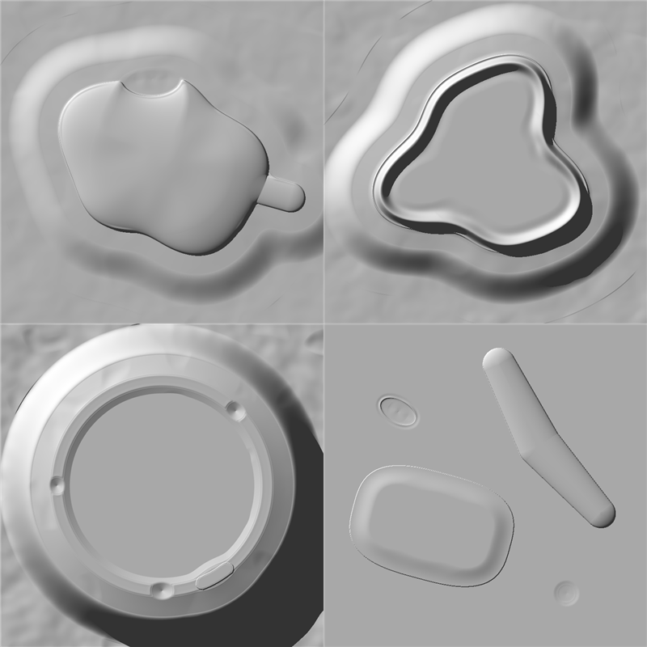

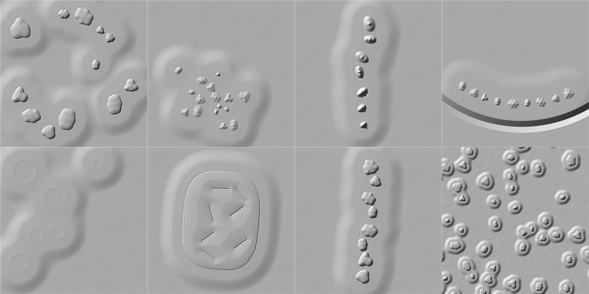

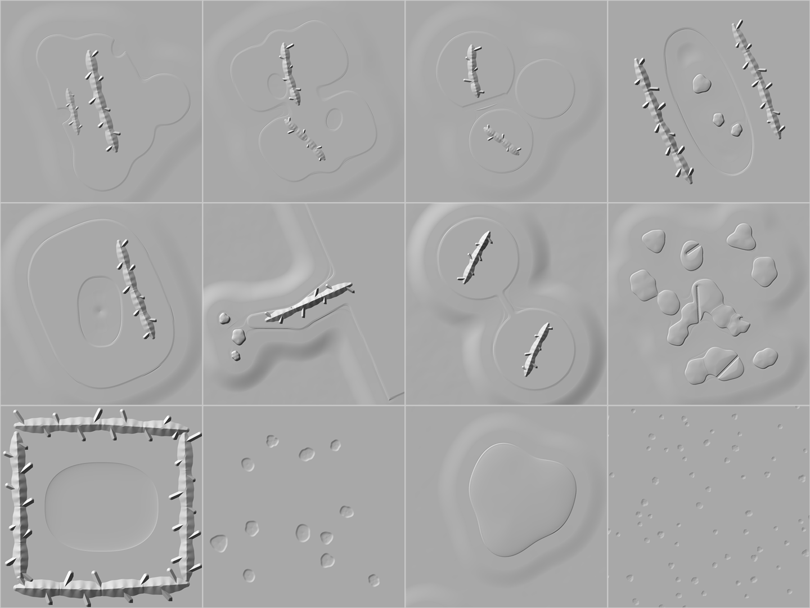

---

### Lakes and rivers: `Water.Drain` and `Water.Apply`

`Water.Drain` drains a coarse grid the script built (the lists `Erosion.StreamPower` takes and returns)
on the CPU and returns its fields as `Terrain.Grid` values:

1. **Breach or fill, per depression** (Lindsay's hybrid): one no deeper than `breach` (3 m) is cut open
   along its way out; one larger than `lake_area` (20 ha) and deeper than `lake_depth` (2 m) is a lake,
   the ground keeping its bowl and the water at the spill level; any other is filled.
2. **Routing and area** (D8 on the result), with `sea_level` as an outlet where given; the grid's edge
   always is one.
3. **Rivers** where the area passes `channel_area` (1 km²): centre lines smoothed along the network,
   width `width_scale * sqrt(A / 1 km²)` and depth `depth_scale * (A / 1 km²)^0.3`, and the distance to the
   nearest one, so a channel stays sharp at any resolution.

`Water.Apply{ height, water }` carves the rivers into a terrain at full resolution (a parabolic bed, banks
rising at `bank`) and returns `height`, `lakes` and `rivers`: water surfaces, above the ground where there
is water and below it elsewhere. Outputs named `lakes` and `rivers` are drawn by the viewer's water.

```lua
local water = Water.Drain{ values = carved, size = { n, n }, origin = { x0, z0 }, cell = 50, sea_level = 0 }
local wet   = Water.Apply{ height = water.height + detail, water = water }
return { height = { value = wet.height }, lakes = { value = wet.lakes }, rivers = { value = wet.rivers } }
```

Detail added after `Water.Drain` must stay under the slope of the ground or it makes new pits.
`assets/scripts/terrains/lakes_rivers.lua` is the worked example. The grid is bounded: outside it
`Terrain.Grid` holds its edge. For water that is designed rather than simulated, use `Water.Network`.

---

### Rivers, lakes and the sea: `Water.Network`

Water as analytic elements that the terrain is made to follow. Nothing is simulated: the terrain is
sampled once on a coarse grid (`Terrain.Sample`, every `cell` metres over `region`) to decide where the
water goes, and from then on each element is a curve or an outline with a level.

```lua
local net = Water.Network{
    terrain = forms, region = { -12000, -12000, 12000, 12000 }, sea_level = 0, seed = params.seed,
    rivers = { { points = { { 0, 9000 }, { 800, 4000 }, { 0, -2000 } }, kind = "glacial", width = 30 },
               { source = { -2500, 9200 }, kind = "braided", width = 20 } },
    lakes  = { { at = { 7000, -7600 }, radius = 1500, level = -45, depth = 110, kind = "trench", islands = 0.5 } },
    generate = { rivers = { count = 3 }, tributaries = 0.3, lakes = { count = 1, on_rivers = 1 } },
    shapes = params.shapes,
}
local wet = net:apply(forms + detail, { detail = detail })
return { height = { value = wet.height }, lakes = { value = wet.lakes }, rivers = { value = wet.rivers },
         sea = { value = wet.sea } }
```

**Rivers.** `points` draws the course; `source` alone traces it down the terrain to the sea, a lake or the
edge of the region. The level never rises downstream: it follows the lowest ground met so far, held under
a graded profile (concave, the kind's `grade`), smoothed over 300 m. `width` (one number, or `{ at source,
at mouth }`), `depth`, `roughness` (meanders and banks, 0 to 1) and `kind`, which decides the valley:

| `kind` | Valley |
| --- | --- |
| `mountain` | a V at 30 degrees |
| `canyon` | walls in benches, deeply incised (grade 3) |
| `gorge` | sheer, narrow walls |
| `glacial` | a U: a flat floor, then parabolic walls |
| `lowland` | meanders, a floodplain a metre over the water, two terraces, levees |
| `braided` | a wide bed of shallow threads and gravel bars |

**Shape of a river.** Its meanders are a sine-generated curve (Langbein and Leopold) with Kinoshita's skew:
bends that loop and lean downstream, swinging by the kind's `omega` (a lowland river loops, a gorge barely
bends), wavelength about eleven widths. In a bend the deepest line runs against the outer bank (a cut bank)
and the bed rises gently to the inner one (a point bar). A generated river's width follows its drainage
area (`10 * sqrt(A / 1 km2)` metres, within `river.width`), a drawn one's goes from source to mouth as given,
and below a confluence a river is wider by what joined it (widths add as the root of the areas). Where a
mountain, gorge or glacial river meets a cliff (25 m or more at 45 % and three times its own slope) it falls
over it: the step is kept, a plunge pool is dug at its foot and the bed shallows into rapids above it; a
canyon cuts back through instead.

**Mouths.** A river that ends in the sea or a lake spreads there. Into a lake, or as a lowland or braided
river into the sea, it splits about 25 widths up into three distributaries over a fan of land a metre and a
half over the water (a delta); otherwise into the sea, its last stretch widens as a funnel to four times
(an estuary). `mouth = "delta" | "estuary" | "none"` on a drawn river chooses; the mouth is where it first
reaches the water, whatever lies beyond in its drawn course.

The valley is an envelope over the channel: the ground is lowered to the level plus the kind's profile
of the distance, which flares so it meets the ground on a curve; it never raises ground, except the
floodplain, which fills holes by up to 3 m; every floodplain is filled before any channel is cut, so none
fills another river's channel. The water and the bed take the channel's own level; the floor, a few widths
out, the level of the course without its meanders, so a wide floor is smooth. Detail given to `apply` goes
back on the cut ground, never under water.

**The network is a tree.** A river ends where it first meets one already made, on that river's course,
and no level is raised to get there: arriving lower, it cuts the river it joins down from the confluence
on, eased in over 300 m; arriving higher, it drops to it over its last stretch. Past the confluence its
water gives way to the river's. A generated river that would meet another within 1.5 km is dropped as a
duplicate.

**Lakes.** `points` (an outline) or `at` and `radius`; `level` in metres, anywhere, under the sea level
too, or `"auto"` (the lowest ground on the shore); `depth`, `islands` (0 to 1) and `kind`: `bowl`,
`trench` (a shelf then cliffs down to a deep floor), `shelf` (shallow out to a drop-off), `crater` (a
raised rim), `cirque` (a headwall on its uphill side), `moraine` (dammed by a ridge across its downhill
side). The floor carries relief, a low rim keeps the water in and the ground around falls towards the lake
at the kind's angle, or at its `shore`'s: `beach`, `rock` or `cliff`. `outlet = true` (or a width) lets it
spill where its shore is lowest, a river leaving there at its level. Generated lakes take the shore of their
water: the contour of their level over the ground. A glacial river strings two lakes down its valley
(paternoster lakes, dammed by moraines; `lakes` on a drawn river for another number).

**The sea** is the ground under `sea_level` connected to the edge of the region. A closed depression
under the sea level is not the sea: it stays dry or holds a lake. The `sea` output is its surface; with
it the viewer draws the sea only there, not as a plane over everything below the level.

**Generated** (`generate`): `rivers = { count = n }` or `{ density = d }` per 100 km² (0 for none) takes
the longest courses to distinct mouths, `spacing` apart; `tributaries` (0 to 1) adds their largest side
branches, which meet them at their level; `river = { kinds, width = { min, max }, min_length, head_area }`.
`lakes = { count, area = { min, max }, altitude = { min, max }, kinds, islands, on_rivers }` fills the
largest natural depressions and dams `on_rivers` valleys. With `kinds = "auto"` (the default) the kind is
read from the ground: steep and high is `glacial` or `mountain`, a plateau `canyon`, flat `lowland`.
By default what is generated depends on the region: export another region and other rivers may be
chosen. `world_cell = s` (metres, e.g. 16000) makes it depend on the world only: the analysis is snapped
to cells of that size plus a ring of cells around them, at a fixed cell size, and `count` is per world
cell. Two exports that touch the same cells get the same rivers and lakes, point for point, so an
infinite world can be exported piece by piece.
`net:summary()` lists what was made, generated ones marked `*`. `net:audit(wet, seed)` walks every
channel as drawn and counts where the water rises and where the ground stands over it; both should be 0
(`test_water` holds it there).

From `--shapes`, features of `kind = "river"` (lines, or a point for a source) and `kind = "lake"`
(polygons) are added, with `river_kind`, `lake_kind`, `width`, `depth`, `level` and `roughness` as
properties.

Each river or lake is one `Hydrology.Carve` node (a fused op, `water.comp.glsl`) and two or three more
to apply it, so a script holds well over a hundred; the grid buffer (16 M values) is shared out between them,
a long river getting coarser cells. Its channel is measured exactly on its course whatever the cells, so
it stays sharp. `assets/scripts/terrains/water_showcase.lua` shows every kind on one map.

## 11. Recipes

### A complete terrain

```lua
local function main(params)
    local amplitude = params.amplitude or 400.0
    local sea       = params.sea_level or 0.0
    local wear      = params.erosion or 24

    -- Base: wavelength ten times the amplitude, so the slopes are terrain and not spikes.
    local base = Noises.fBm{
        frequency = 0.0002, octaves = 6, lacunarity = 2.0, persistence = 0.5,
        amplitude = amplitude, offset = sea, seed = params.seed,
    }

    -- The mask reads a three-octave gradient, not the base's own: the gradient of a six-octave field
    -- is dominated by its finest octave and the mask would flicker sample to sample.
    local shape = Noises.fBm{
        frequency = 0.0002, octaves = 3, amplitude = amplitude, offset = sea, seed = params.seed,
    }
    local ridges = Noises.Ridged{
        frequency = 0.0004, octaves = 4, amplitude = amplitude * 0.6, offset = sea,
        seed = params.seed + 1,
    }
    local blended = Combine.Blend{
        a = base.value, b = ridges.value,
        mask = Masks.Slope{ input = shape.gradient, min = 0.3, max = 1.1 },
    }

    -- Water cuts, then thermal settles the spoil. Both are slopes, so the same script describes the
    -- same terrain at any sample spacing.
    local carved = Erosion.Hydraulic{
        input = blended, iterations = wear, rain = 0.5, capacity = 6.0,
    }
    local settled = Erosion.Thermal{
        input = carved, iterations = wear // 2,
        talus = math.tan(math.rad(35.0)), strength = 0.3,
    }

    local low, high = sea - amplitude * 1.1, sea + amplitude * 1.1
    local height    = Curves.Clamp{ input = settled, min = low, max = high }

    return {
        height  = { value = height, range = { low, high } },
        normals = { value = Terrain.Normals{ input = Terrain.Gradient{ input = height } } },
    }
end

return main
```

### A rock-versus-grass mask

```lua
local shape = Noises.fBm{ frequency = 0.0002, octaves = 3, amplitude = 400.0 }
local rock  = Masks.Slope{ input = shape.gradient, min = 0.5, max = 0.9 }
-- Sharper selection without moving the thresholds.
local tight = Curves.Power{ input = rock, exponent = 2.0 }
return { rock = { value = tight, range = { 0, 1 } } }
```

### Snow above an altitude, but not on cliffs

```lua
local base  = Noises.fBm{ frequency = 0.0002, amplitude = 400.0 }
local alt   = Curves.Smoothstep{ input = base.value, min = 150.0, max = 300.0 }
local steep = Masks.Slope{ input = base.gradient, min = 0.6, max = 0.9 }
local snow  = alt * (1.0 - steep)
return { snow = { value = snow, range = { 0, 1 } } }
```

### A domain warp

```lua
local p    = Terrain.Coords{ domain = 2 }
local wx   = Noises.fBm{ frequency = 0.0005, amplitude = 300.0, seed = 7 }
-- A position field is bent by feeding displaced coordinates into something that is a function of
-- position. For a ramp that is just arithmetic; for a shape it is `position =`, which `Shapes.Warp`
-- builds for you from two noise fields.
local ramp = (p.x + wx.value) * 0.001
return { warped = { value = ramp, range = { 0, 4 } } }
```

For shapes, pass the warp as the shape's `position`:

```lua
local position = Shapes.Warp{ amplitude = 60.0, frequency = 0.004, seed = 7 }
local outline  = Shapes.Circle{ radius = 200, position = position }
return { mask = { value = Shapes.Mask{ shape = outline, feather = 20 }, range = { 0, 1 } } }
```

---

## 12. Errors

Every binding reads the calling line out of the Lua stack before it touches the graph, so a failure is
reported where it was written.

```
terrain.lua:12: [script] Noises.fBm does not take 'persistance'; it accepts domain, kind, frequency, ...
terrain.lua:14: [validation] Normals expects R2->R2 input, got R2->R1
```

| Stage | Meaning |
| --- | --- |
| `[script]` | a binding rejecting its own arguments: unknown key, wrong type, out of range |
| `[validation]` | a graph builder rejecting a mapping |
| `[compile]` | the compiler: usually a halo over the limit |

An unknown key is an error, never silently ignored, and the message lists the keys the op does accept.

## 13. What a script cannot do

Only `base`, `math`, `string` and `table` are opened, so there is no `io`, no `os`, no `package`, no
`require`, no `debug` and no `coroutine`: a script cannot start a process or load a C module.

`dofile`, `loadfile`, `load`, `collectgarbage`, `pcall` and `xpcall` are removed from `base` after it
opens, which was checked by enumerating `_G` from a script. The loaders would let a script read a file
or run code the sidecar's script hash does not describe, and `pcall` would let it swallow the time
budget's error and keep looping. The budget is 10 s of wall clock for building the graph; exceeding it
is an error with a line number.

What a script genuinely cannot do is branch on terrain data, because none exists while it runs: a
handle is a promise, not a value.
